<div align="center">

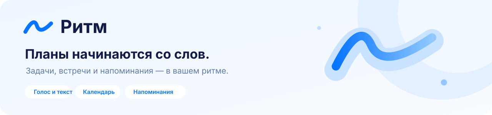

**Русскоязычный ассистент для задач, встреч и напоминаний.**
Текст и голос → понятный план → сохранённое действие.

[](https://github.com/NIDJEL/assistant-ai/actions/workflows/ci.yml)


**[Открыть прототип](https://meinangelplatz.top) · [Материалы для организаторов](SUBMISSION.md) · [Запуск](#запуск-одной-командой) · [Документация](docs/README.md)**

</div>

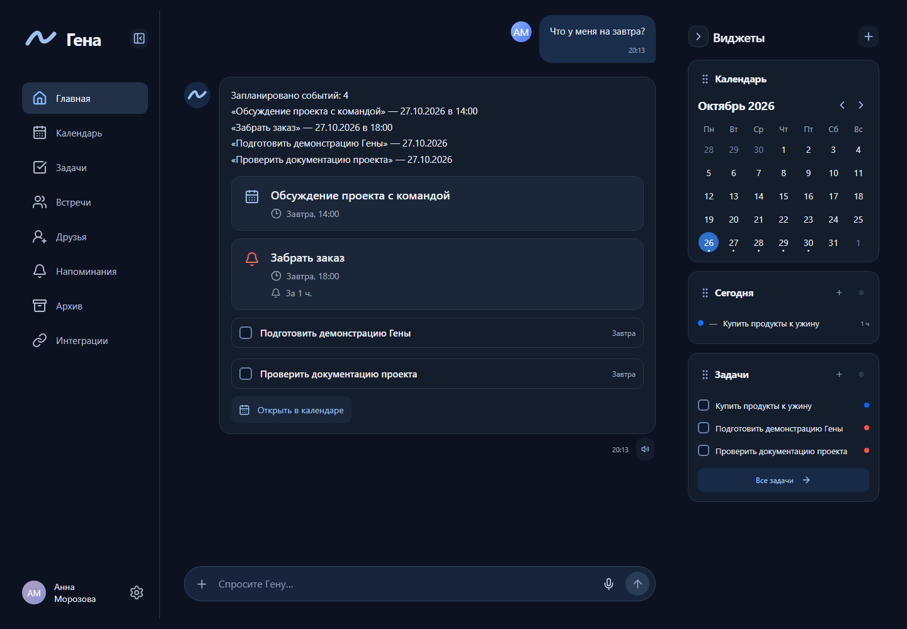

## Что делает проект

Гена помогает вести личные дела и договариваться о встречах. Пользователь может написать запрос или надиктовать его, проверить текст, уточнить детали и получить результат в календаре. Интерфейс работает на компьютере и телефоне, поддерживает светлую/тёмную тему и установку как PWA.

| Возможность | Реализация |
| --- | --- |
| Задачи | Сроки, приоритеты, подзадачи, метки, завершение и архив. |
| Встречи | Дата, время, длительность, участники, место и проверка пересечений. |
| Напоминания | Упреждение, повторения в редакторе, серверный worker и Web Push. |
| Чат | Создание, поиск, перенос, контекстные уточнения, подтверждение удаления и групповых изменений. |
| Голос | Groq STT превращает запись в редактируемый черновик; Azure TTS озвучивает ответ по нажатию. |
| Друзья | Заявки по коду, теги, приглашения, общее свободное время и согласование переноса. |
| Яндекс | Вход через Яндекс ID; отдельное согласие на экспорт дел в Яндекс Календарь. |
| Данные | Импорт встроенного CSV из 1000 записей или своего файла; защита от повторного импорта. |
| Интерфейс | Меню «+» с тремя шаблонами, адаптивные панели интеграций, виджеты, страницы 4xx/5xx. |

Модель понимает запрос, но не получает доступ к базе. **Go проверяет операцию, права, даты, конфликт и выбранные записи; PostgreSQL сохраняет результат транзакционно.** Внешние интеграции выполняются через очереди, поэтому сетевой сбой провайдера не отменяет локально сохранённое дело.

## Запуск одной командой

Нужны работающий **Docker Engine/Desktop с Compose v2**, **Python 3.10+** и интернет для первой загрузки образов/зависимостей. Go и Node.js на хосте для запуска не нужны. Для комфортной сборки рекомендуется выделить Docker около 4 ГБ RAM и несколько гигабайт свободного диска.

```bash
git clone https://github.com/NIDJEL/assistant-ai.git
cd assistant-ai
```

**Windows / PowerShell:**

```powershell
python scripts/service.py up
# либо .\scripts\up.ps1
```

**Linux / macOS:**

```bash
./scripts/up.sh
# либо python3 scripts/service.py up
```

Откройте **[http://localhost:8081](http://localhost:8081)** и создайте аккаунт. Launcher создаст `.env`, независимые случайные пароли, постоянные VAPID-ключи, соберёт React/Go, запустит PostgreSQL и приложение, дождётся healthcheck. Секреты не выводятся в консоль. Повторный запуск использует прежние ключи и данные.

| Режим | Без внешних ключей | С GigaChat и настроенными провайдерами |
| --- | --- | --- |
| Запуск | `python scripts/service.py up` | `python scripts/service.py up --mode full` |
| Интерфейс, CRUD, CSV, календарь, друзья | Да | Да |
| Текстовый ассистент | Детерминированные правила, ограниченные формулировки | `simple_llm`, свободные формулировки через GigaChat |
| Диктовка / озвучивание | Недоступны без ключей | Groq / Azure при соответствующей конфигурации |
| Яндекс Календарь | Требуют OAuth-настройки и подключения аккаунта | Те же явные OAuth-подключения |

Для полного режима заполните ключи в `.env`; при необходимости укажите путь к проверенному CA bundle. Ключи GigaChat, Groq, Azure и OAuth — разные настройки. Launcher не регистрирует приложения у внешних провайдеров и не имитирует их подключение. [Пошаговый запуск и настройка →](docs/QUICKSTART.md)

```bash
python scripts/service.py status
python scripts/service.py check
python scripts/service.py logs
python scripts/service.py down
```

`down` сохраняет PostgreSQL-том. Скрипт не выполняет `down -v`. Чтобы использовать другой порт/независимую установку:

```bash
python scripts/service.py up --env-file .env.review --project rhythm-review --port 18086
```

Для всех последующих команд этой установки передавайте те же `--env-file` и `--project`.

## Как проверить за 5–10 минут

1. Создайте свой аккаунт, пройдите знакомство с приложением.
2. Создайте задачу, встречу и напоминание через редакторы. Проверьте календарь и архив.
3. Нажмите «+» в чате: команда подставляется в строку и не отправляется без вашего действия.
4. В режиме правил попробуйте «Поставь задачу купить билеты» и «Добавь встречу с Иваном завтра в 15:00». Для свободных формулировок и голоса используйте полный режим или HTTPS-прототип.
5. В «Настройках → Загрузка данных» загрузите примеры или свой CSV. Обновите страницу и убедитесь, что записи сохранились.
6. Для проверки изоляции откройте другой аккаунт: данные первого аккаунта не должны быть доступны.

[Полный сценарий для организаторов, ожидаемые результаты и ограничения →](SUBMISSION.md)

## Актуальный интерфейс

| Календарь | Задачи |
| --- | --- |
| 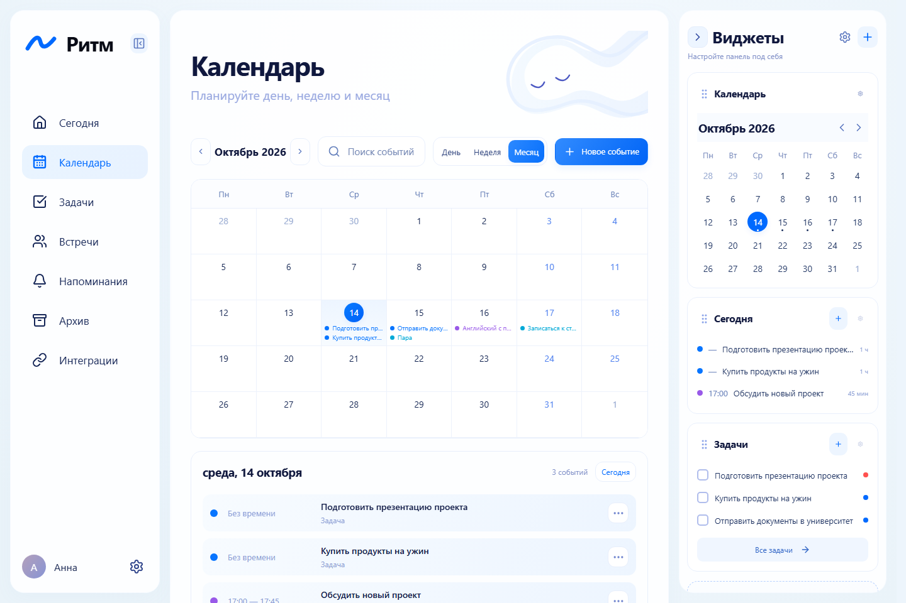 | 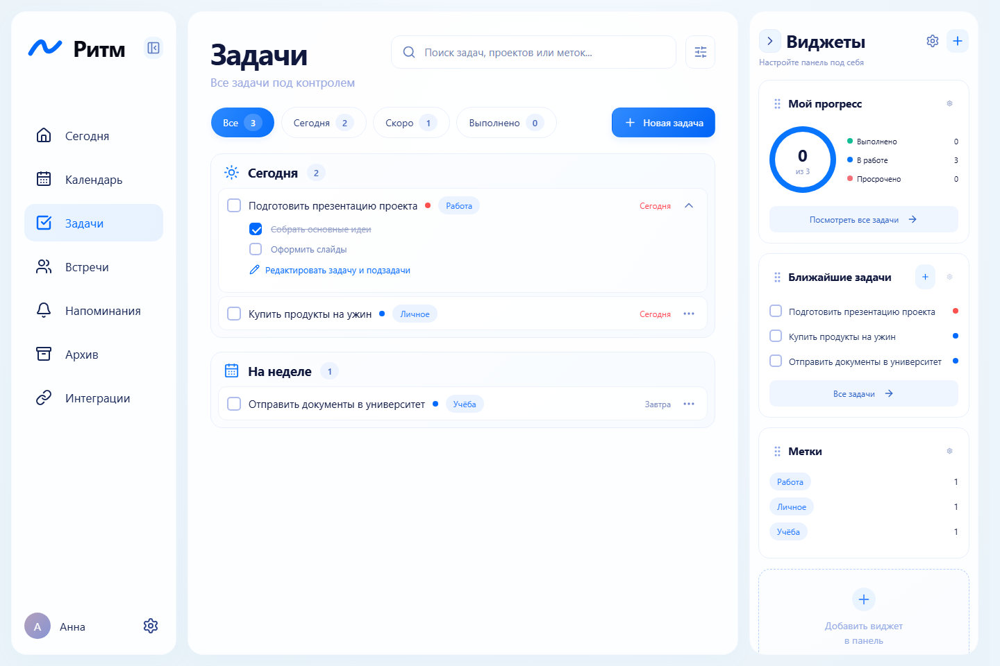 |

| Встречи | Напоминания |
| --- | --- |
| 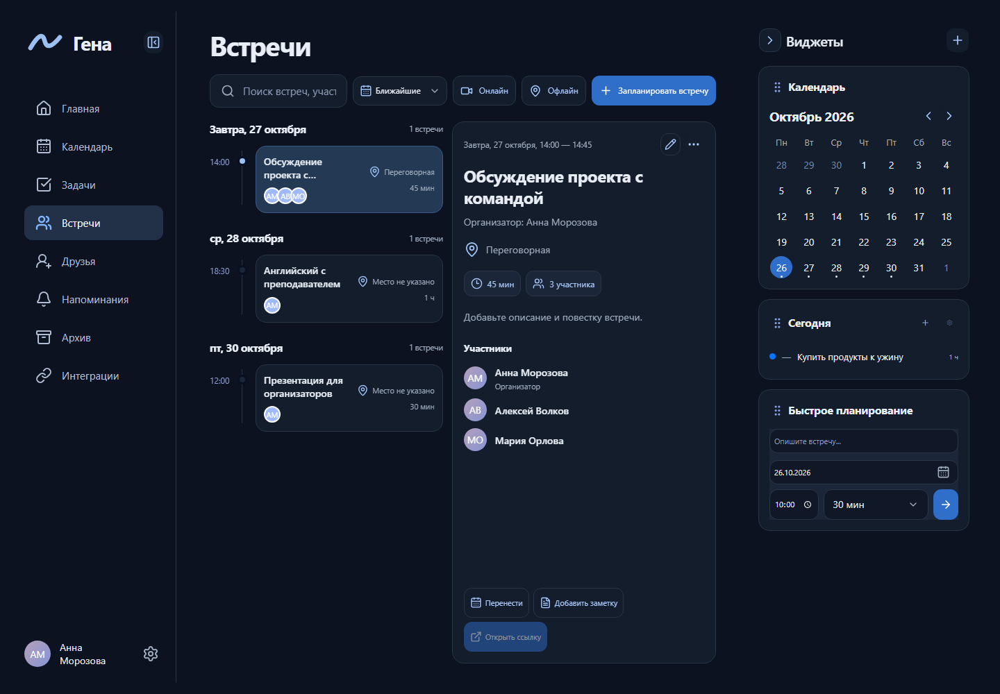 | 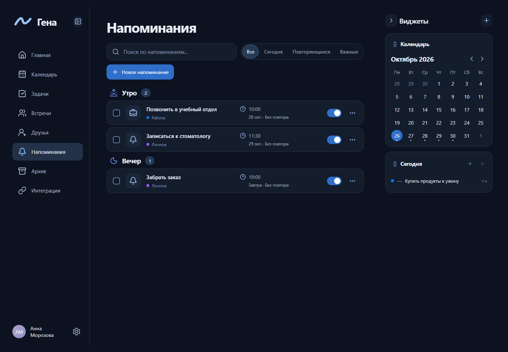 |

| Светлая тема | Интеграции |
| --- | --- |
| 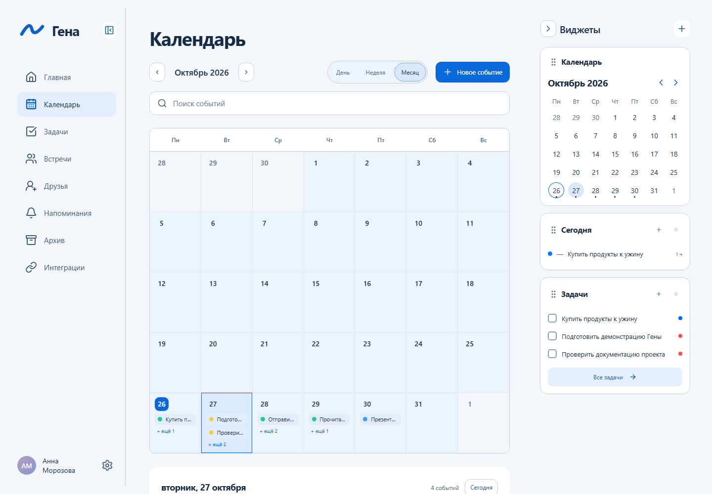 | 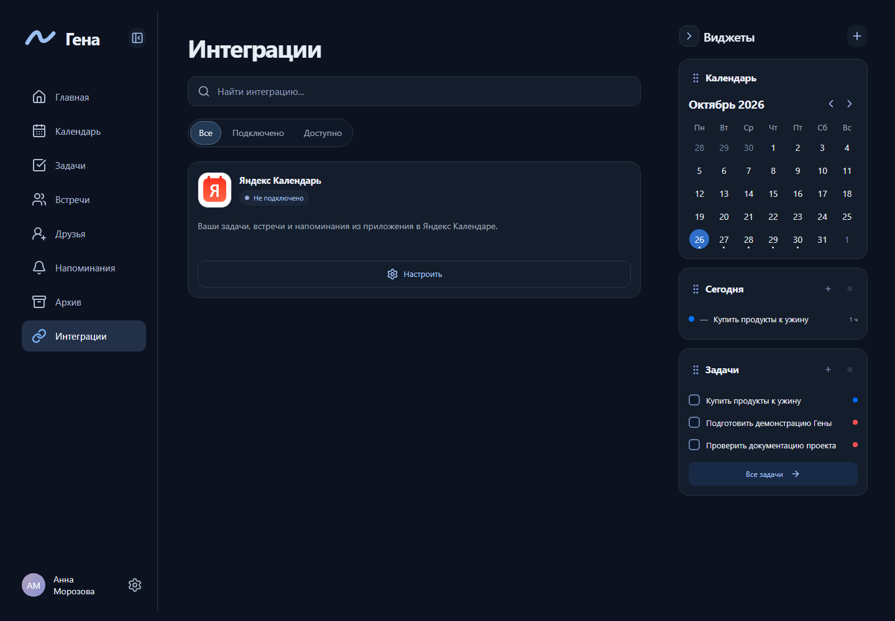 |

| Команды на телефоне | Настройки интеграции на телефоне |
| --- | --- |
| 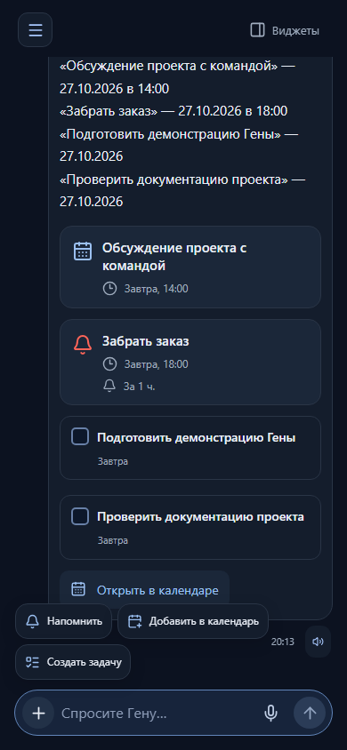 | 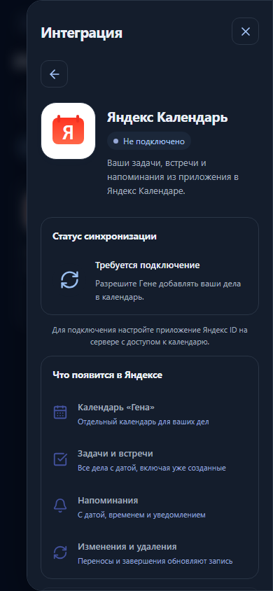 |

Снимки сделаны 26 октября 2026 года на реальном локальном приложении с демонстрационными аккаунтами и PostgreSQL. API не подменялся; отключённые внешние интеграции показаны честно. [Все 20 экранов и методика съёмки](docs/SCREENSHOTS.md) · [Манифест и SHA256](docs/screenshots/current/manifest.json).

## Архитектура


**Модульный монолит:** один Go-процесс обслуживает API, React build и фоновые workers. PostgreSQL — единственное рабочее хранилище. Node.js нужен только для сборки/разработки. SQLite используется для явного импорта прежней базы и регрессионных тестов.

| Схема | Что объясняет |
| --- | --- |
| [Компоненты](docs/diagrams/components.svg) | HTTP API, ассистент, исполнитель, поиск, repository и workers. |
| [UML: классы](docs/diagrams/domain-uml.svg) | Основные интерфейсы и зависимости Go-модулей. |
| [UML: последовательность](docs/diagrams/command-sequence.svg) | Путь команды, граница LLM, транзакция и outbox. |
| [UML: состояния](docs/diagrams/confirmation-state.svg) | Уточнение, выбор, подтверждение, исполнение и отмена. |
| [ER: данные](docs/diagrams/data-model.svg) | Владельцы записей, диалоги, интеграции и уведомления. |
| [Голос](docs/diagrams/voice-flow.svg) | Запись → Groq → проверка черновика → команда → Azure TTS. |
| [Развёртывание](docs/diagrams/deployment.svg) | CI/CD, архив релиза, backup, health и откат. |

[Архитектурные решения и исходники Mermaid →](docs/ARCHITECTURE.md)

## Проверки и эксплуатация

CI проверяет Go с PostgreSQL и race detector, frontend unit-тесты, TypeScript/Vite, Chromium smoke, скрипты запуска и release receiver. Перед выпуском проверяется готовый runtime-контейнер. Успешный push в `main` автоматически уходит на VPS через ограниченный SSH receiver: backup базы, обновление только `app`, проверка контейнера и HTTPS, откат приложения при ошибке.

- [Воспроизводимая разработка и тесты](docs/DEVELOPMENT.md)
- [Текущая проверка готовности](docs/ASSIGNMENT_VALIDATION.md)
- [Продакшен, backup и восстановление](deploy/README.md)
- [CI/CD и настройка receiver](deploy/CI_CD.md)

## Ограничения, которые нужно учитывать при оценке

- Режим правил и `simple_llm` имеют разные возможности; key-free запуск не заменяет оценку свободной речи через GigaChat.
- Качество распознавания, квоты и доступность внешних API зависят от провайдеров. Автоматические тесты не подтверждают работу физического микрофона на любом устройстве.
- Повторения задач/напоминаний задаются в редакторе; повторяющиеся встречи не поддерживаются. Контракт `simple_llm` не создаёт повторения.
- Яндекс Календарь синхронизируется из Гены наружу.
- Web Push требует разрешения устройства; на iPhone/iPad используется установленная PWA. Офлайн-редактирование и восстановление пароля по email пока не реализованы.
- Поиск использует русскую нормализацию, словарь и нечёткое сравнение; это не гарантия понимания любой перефразировки.

## Навигация по исходникам

```text
cmd/server/                   HTTP-приложение и запуск workers
internal/assistant, nlu, llm/  Диалог, контракт операции и GigaChat
internal/calendar, search/    Дела, даты, конфликты, CSV и поиск
internal/auth, social/        Аккаунты, друзья и совместные встречи
internal/integrations/        OAuth и Яндекс Календарь
internal/notifications/       Напоминания и Web Push
internal/storage/postgres/    Хранилище и встроенные SQL-миграции
web/                          React, стили, unit/e2e, съёмка интерфейса
scripts/                      Запуск одной командой и проверки
deploy/                      Production Compose, Nginx, CI/CD receiver
docs/                        Руководства, SVG/Mermaid, скриншоты
```

Полный указатель — [docs/README.md](docs/README.md). После локального запуска доступны [OpenAPI](http://localhost:8081/docs), [JSON-контракт](http://localhost:8081/openapi.json) и [галерея архитектуры](http://localhost:8081/architecture). Production Nginx закрывает эти технические маршруты.
