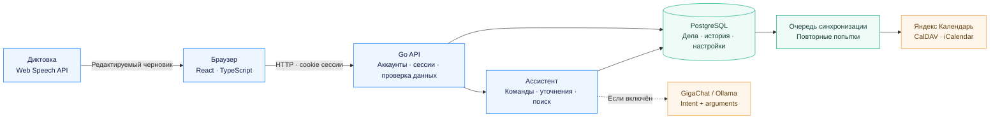
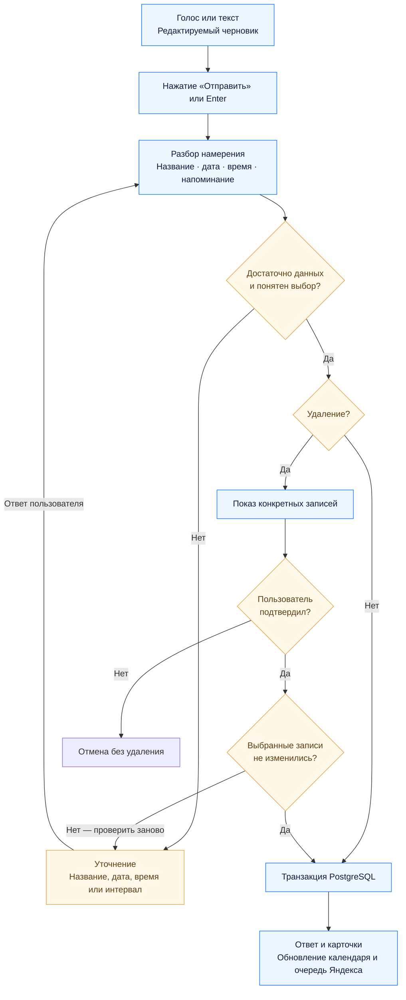

<div align="center">


<p><strong>Личный веб-ассистент для задач, встреч и напоминаний на русском языке.</strong><br/>
Говорите или пишите обычными словами — Гена поможет превратить их в понятный план.</p>

[](https://github.com/NIDJEL/assistant-ai/actions/workflows/ci.yml)


Актуальная версия: **`20261017-simple-llm-01`**. [Публичный прототип](https://meinangelplatz.top).
Исходники в ветке `main` — единственная поддерживаемая версия. [Состав и синхронизация](docs/RELEASE.md).

**[Возможности](#возможности) · [Запуск](#быстрый-запуск) · [Как это устроено](#как-это-устроено) · [Документация](#документация)**

</div>


## Возможности

| | Что умеет Гена |
| --- | --- |
| **Разговорные команды** | Создание, поиск, перенос, завершение и удаление по названию, дате и времени. При неоднозначности — уточнение. |
| **Голос под ваш контроль** | Диктовка остаётся редактируемым черновиком. Отправка только кнопкой или Enter; пауза ничего не отправляет. |
| **Персональная адаптация** | Исправления похожих имён и слов запоминаются в контексте после успешной отправки отредактированной диктовки. |
| **Единый план** | Календарь на месяц, неделю и день; задачи с приоритетами и подзадачами; встречи с участниками и местом. |
| **Напоминания заранее** | Время события и время сигнала разделены. «Тогда напомни за час» меняет интервал у последней записи. |
| **Яндекс Календарь** | Автоматическая отправка дел с датой в отдельный календарь «Ассистент Гена», включая изменения, удаления и настройки напоминаний. |
| **Ваше пространство** | Аккаунты, фото профиля, onboarding, виджеты с перетаскиванием и сохранением настроек, мобильная навигация. |
| **Восстановление** | Удалённые записи доступны в архиве. Массовое удаление требует подтверждения конкретного списка. |

Короткое имя продукта — **Гена**, полное — **Ассистент Гена**. Вход: почта или Яндекс ID.

### Скажите своими словами

| Запрос | Результат |
| --- | --- |
| «Завтра пара в 12:50. Поставь уведомление на 12:00» | **Пара** в 12:50, напоминание за 50 минут. |
| «Добавь встречу с Олей завтра в 15:00» | Создание встречи; интервал уведомления можно задать следующей репликой. |
| «Перенеси завтрашнюю встречу с Олей на пятницу в 17:00» | Выбор исходной встречи и перенос на новую дату и время. |
| «Удали напоминание позвонить маме завтра» | Выбор по названию и дате, затем подтверждение удаления. |
| «Удали все записи на завтра» | Просмотр списка и подтверждение. При изменении записей потребуется проверить список заново. |

`simple_llm` передаёт свободную речь и компактный контекст в GigaChat-3-Ultra. Модель возвращает короткие intent/arguments, Go рассчитывает время и безопасно выполняет действие. Например: «вторую перенеси на 16», «нет, лучше на 17», «а только завершённые». Старый runtime доступен через `GENA_NLU_MODE=semantic_plan_legacy`. [Простая архитектура и ручной тест](docs/SIMPLE_LLM_RUNTIME.md).

Номера записей помнить не нужно. Если совпадений несколько, можно ответить «ту, что завтра в 15:00», «вторую» или выбрать кнопку с названием и датой.

<details>
<summary><strong>Посмотреть календарь, задачи и интеграции</strong></summary>

| Календарь | Задачи |
| --- | --- |
|  |  |

| Интеграции | Мобильный интерфейс |
| --- | --- |
|  |  |

Скриншоты актуальной версии сняты на демонстрационном аккаунте. Google Calendar и Zoom пока помечены «Скоро».

</details>

## Быстрый запуск

Нужны **Docker Engine / Docker Desktop** и **Docker Compose v2**.

```bash
git clone https://github.com/NIDJEL/assistant-ai.git
cd assistant-ai
cp .env.example .env
```

В PowerShell вместо последней команды: `Copy-Item .env.example .env`.

Заполните в `.env`:

| Переменная | Что указать |
| --- | --- |
| `POSTGRES_PASSWORD` | Собственный случайный пароль базы. |
| `SESSION_SECRET` | Случайный секрет длиной не менее 32 символов. Сохраните его для последующих запусков. |
| `PUBLIC_URL` | Адрес приложения; для стандартного запуска — `http://localhost:8081`. |

```bash
docker compose up --build -d --wait
```

Без GigaChat credentials используйте `GENA_NLU_MODE=semantic_plan_legacy` в `.env`. Для `simple_llm` нужны GigaChat credentials и compose override, описанный в [инструкции](docs/GIGACHAT_CONFIGURATION.md).

Откройте **[localhost:8081](http://localhost:8081)** и создайте аккаунт.

**[OpenAPI](http://localhost:8081/docs)** · **[Схемы в приложении](http://localhost:8081/architecture)** — доступны после запуска на вашем компьютере.

```bash
docker compose logs -f app
docker compose down
```

Данные сохраняются в PostgreSQL-томе `rhythm-postgres-data`. Обычный `down` сохраняет том; `down -v` удаляет данные. Новый аккаунт начинается с пустого плана. Демоданные из CSV импортируются только явным действием и только в текущий аккаунт.

### Подключение Яндекс Календаря

Задайте `YANDEX_CLIENT_ID`, `YANDEX_CLIENT_SECRET`, `YANDEX_REDIRECT_URI`; в приложении Яндекс OAuth включите права профиля и `calendar:all`. Callback должен соответствовать `PUBLIC_URL`.

После настройки сервера кнопка **«Подключить Яндекс Календарь»** в onboarding сразу открывает OAuth и возвращает в чат. Подключить позже и управлять календарём можно в **Интеграциях**.

### Фоновые напоминания и установка

Задайте три переменные `WEB_PUSH_VAPID_PUBLIC_KEY`, `WEB_PUSH_VAPID_PRIVATE_KEY`, `WEB_PUSH_SUBJECT`; пару создаёт `go run ./cmd/web-push-keys`. Затем включите уведомления в настройках Гены на каждом устройстве. Сервер обрабатывает сроки и повторения без открытой вкладки. На iPhone/iPad сначала добавьте Гену на экран Домой и запустите с иконки. [Настройка, платформы и проверки Web Push](docs/WEB_PUSH.md).

[Подробная настройка, синхронизация и уведомления →](docs/YANDEX_CALENDAR.md)

## Как это устроено

### Архитектура



Production-контейнер обслуживает Go API и собранный frontend. PostgreSQL обязателен; Node.js нужен на этапе сборки. Данные, история и настройки изолированы по аккаунтам. Изменение дела и постановка в очередь Яндекса записываются одной транзакцией.

### От слов к действию



Для группового удаления список ограничен 100 записями за один запрос. Новые записи не добавляются к уже подтверждаемому списку. Повтор одного запроса с тем же `request_id` возвращает сохранённый результат.

### Что важно знать

- **Речь.** Используется распознавание браузера; качество зависит от его сервиса и микрофона. Персональная адаптация исправляет текст в контексте, акустическая модель на голосе пользователя не обучается.
- **Уведомления.** Серверный worker обрабатывает сроки и повторения. Web Push доставляет сигналы на подписанные устройства при закрытой странице; нужны настройка VAPID, HTTPS и разрешение браузера. iPhone/iPad используют установленную PWA. Без подписки доступны уведомления внутри открытого приложения.
- **Яндекс.** Синхронизация направлена из приложения в Яндекс. Изменения в самом Яндексе не импортируются. Каналы доставки push/почты разрешаются в настройках Яндекса.
- **Планирование.** Поддерживаются разовые дела и повторяющиеся задачи/напоминания, включая будни, месяцы и годы. Повторяющиеся встречи и восстановление пароля по email пока не реализованы.
- **LLM.** Основной runtime — `GENA_NLU_MODE=simple_llm` с GigaChat. Go обрабатывает точные подтверждения/отмену, остальную речь понимает модель. `semantic_plan_legacy` сохраняет прежний planner и rules для разработки. [Контракты и локальные проверки](docs/SIMPLE_LLM_RUNTIME.md).

[Подробно о командах, адаптации речи и напоминаниях →](docs/ASSISTANT_BEHAVIOR.md)

[GigaChat: локальная настройка и production configuration →](docs/GIGACHAT_CONFIGURATION.md) · [Результаты semantic evaluation →](docs/GIGACHAT_SEMANTIC_REPORT.md)

GigaChat pipeline: `text/voice + compact context → GigaChat intent/arguments → Go validation/calendar/target resolution → existing executor`.
Модель — `GigaChat-3-Ultra`. Старые SemanticPlan, evidence, canonicalizer и русский command parser обходятся в новом пути. [Контракты, проверки и запуск](docs/SIMPLE_LLM_RUNTIME.md). Production включается через существующий GigaChat compose override.

Диктовка: `getUserMedia → MediaRecorder → POST /api/voice/transcribe → Groq whisper-large-v3-turbo → черновик → ручная отправка → simple_llm`. Настройте `GENA_STT_PROVIDER=groq`, `GROQ_API_KEY` и `GROQ_STT_MODEL=whisper-large-v3-turbo` только на backend. Записи до 15 МиБ обрабатываются в памяти; автоматической отправки и автоматического перехода на SpeechRecognition нет. Проверка физического микрофона выполняется вручную на устройстве. [Контракт дат и голосовой ввод](docs/DEADLINES_AND_VOICE.md).

## Разработка и проверки

**Go 1.26+ (production: 1.27.2) · Node.js 24 · pnpm 11.25 · PostgreSQL 17**

```bash
pnpm --dir web install --frozen-lockfile
pnpm --dir web build
go run ./cmd/server
```

Для запуска без Docker задайте `DATABASE_URL` и `SESSION_SECRET` в `.env`. Для hot reload задайте `APP_ADDR=127.0.0.1:8082`; Vite запускается командой `pnpm --dir web dev`; настройте `PUBLIC_URL` на фактический адрес браузера и соответствующие OAuth callback.

```bash
# Тестовая PostgreSQL-база должна быть доступна по TEST_DATABASE_URL.
go test ./...
go vet ./...
go test -race ./...

pnpm --dir web test
pnpm --dir web build
pnpm --dir web exec playwright install chromium
pnpm --dir web e2e
```

CI проверяет Go, PostgreSQL, frontend, браузерные сценарии и Docker-сборку. Без `TEST_DATABASE_URL` Go-тесты PostgreSQL пропускаются. На Windows для `-race` нужен C-компилятор; Linux-проверка описана в [Go parity](docs/GO_PARITY.md). Браузерные тесты создают отдельные аккаунты и используют управляемый Web Speech mock.

### Структура проекта

```text
cmd/                 Запуск сервера и импорт старой SQLite
internal/            Go API, ассистент, NLP, auth, хранилища и CalDAV
web/                 React UI, диктовка, виджеты и браузерные тесты
docs/                Схемы, инструкции и скриншоты
tests/contract/      Контракты, PostgreSQL и интеграционные сценарии
testdata/parity/     Общий корпус и миграционные фикстуры
```

SQLite-импорт и фиксированный корпус совместимости сохранены для миграции и регрессий. Единственный runtime — Go + React + PostgreSQL. Предыдущая Python-версия, старый статический интерфейс и локальные LLM-эксперименты исключены из основной ветки; они сохранены в резервной копии до очистки.

## Документация

| Раздел | Что внутри |
| --- | --- |
| [Команды, речь и уведомления](docs/ASSISTANT_BEHAVIOR.md) | Уточнения, безопасный выбор, персональная адаптация и доставка сигналов. |
| [Яндекс Календарь](docs/YANDEX_CALENDAR.md) | OAuth, CalDAV, очередь, хранение токенов и ограничения. |
| [Web Push и PWA](docs/WEB_PUSH.md) | VAPID, серверные напоминания, устройства, установка iPhone и ручная проверка. |
| [Onboarding](docs/ONBOARDING.md) | Прямое подключение Яндекса и возврат в чат. |
| [Аккаунты и PostgreSQL](docs/ACCOUNTS.md) | Сессии, изоляция, OAuth и импорт прежних данных. |
| [Проверки совместимости](docs/GO_PARITY.md) | Корпус совместимости, SQLite-миграции и проверки. |
| [Production-сервер](deploy/README.md) | HTTPS, SSH-доступ, резервные копии и обновление развернутого приложения. |

<details>
<summary>Обновить скриншоты README</summary>

После сборки и запуска приложения:

```bash
pnpm --dir web exec node scripts/capture-readme.mjs
```

По умолчанию используется `http://localhost:8081`; переменная `P1_BASE_URL` задаёт другой адрес. Скрипт создаёт новый демонстрационный аккаунт и снимает реальные страницы без пользовательских данных.

</details>
