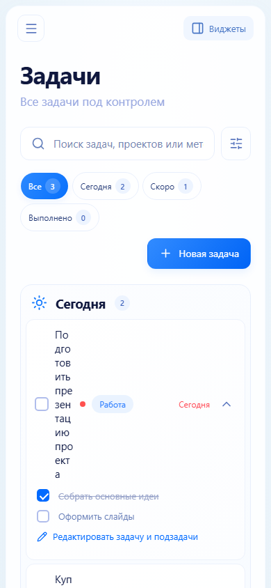
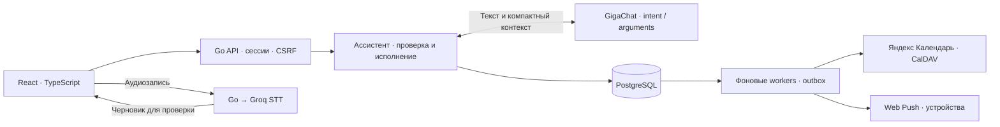

<div align="center">


<p><strong>Личный ассистент для задач, встреч и напоминаний на русском языке.</strong><br />
Скажите, что нужно сделать. Проверьте план. Освободите голову для важного.</p>

[](https://github.com/NIDJEL/assistant-ai/actions/workflows/ci.yml)


**[Возможности](#возможности) · [Запуск](#быстрый-запуск) · [Архитектура](#архитектура) · [Разработка](#разработка) · [Документация](#документация)**

**[Открыть работающий прототип](https://meinangelplatz.top) · [Сценарии для проверки тестового](docs/ASSIGNMENT_REVIEW.md)**

</div>


## Возможности

| | Что можно делать |
| --- | --- |
| **Планировать словами** | Создавать задачи, встречи и напоминания; искать, переносить и завершать дела в диалоге. |
| **Диктовать и редактировать** | Записать голос, получить текст через Groq и проверить черновик перед ручной отправкой. |
| **Видеть весь день** | Календарь на месяц, неделю и день; задачи с приоритетами и подзадачами; встречи с местом и участниками. |
| **Планировать вместе** | Друзья по персональному коду, личные теги, приглашения, общие свободные интервалы и согласование переносов в интерфейсе и чате. [Подробнее →](docs/FRIENDS_AND_SCHEDULING.md) |
| **Получать напоминания** | Настроить упреждение, включить Web Push на устройствах и установить приложение как PWA. |
| **Подключить Яндекс** | Войти через Яндекс ID и отдельно разрешить отправку дел в Яндекс Календарь. |
| **Управлять своим пространством** | Настроить профиль и виджеты, работать с телефона, восстановить удалённое из архива. |

### От фразы к делу

| Вы говорите | Гена помогает |
| --- | --- |
| «Мне нужно подготовить смету до двадцатого» | Создать задачу с дедлайном на ближайшее 20-е число. |
| «Добавь встречу с Олей завтра в 15:00» | Создать встречу на указанное время. |
| «Покажи задачи на эту неделю» → «Вторую перенеси на 16:00» | Выбрать запись из последнего списка и изменить время. |
| «Удали все записи на завтра» | Показать конкретный список и запросить подтверждение. |

Модель разбирает речь, Go проверяет аргументы, вычисляет даты и выбирает записи текущего пользователя. Неоднозначный запрос требует уточнения. Удаление и групповые изменения выполняются после подтверждения; удалённые записи доступны в архиве.

<details>
<summary><strong>Посмотреть интерфейс</strong></summary>

| Календарь | Задачи |
| --- | --- |
|  |  |

| Интеграции | На телефоне |
| --- | --- |
|  |  |

Скриншоты сняты на демонстрационном аккаунте. Google Calendar и Zoom требуют отдельной OAuth-конфигурации сервера и подключения аккаунта.

</details>

## Быстрый запуск

Для проверки голосового ассистента откройте **[работающий прототип](https://meinangelplatz.top)**, создайте аккаунт и разрешите микрофон. Диктовка создаёт редактируемый черновик; нажмите отправку, чтобы выполнить запрос. [Короткая проверка всех обязательных сценариев](docs/ASSIGNMENT_REVIEW.md).

Для локального запуска нужны **Docker** и **Docker Compose v2**. Ниже приведён запуск без внешних ключей: режим правил с текстовым вводом. Для свободной речи через LLM и диктовки включите GigaChat и Groq по инструкциям ниже; возможности этих режимов различаются.

```bash
git clone https://github.com/NIDJEL/assistant-ai.git
cd assistant-ai
cp .env.example .env
```

В PowerShell скопируйте файл командой `Copy-Item .env.example .env`.

Откройте `.env` и задайте:

```dotenv
POSTGRES_PASSWORD=<случайный пароль из латинских букв и цифр>
SESSION_SECRET=<независимый случайный секрет не короче 32 символов>
PUBLIC_URL=http://localhost:8081
GENA_NLU_MODE=semantic_plan_legacy
GENA_SEMANTIC_PROVIDER=rules
GENA_STT_PROVIDER=
```

Пароль и секрет сгенерируйте отдельно и замените значения в угловых скобках. Эти настройки переопределяют значения для LLM и диктовки из `.env.example`.

```bash
docker compose up --build -d --wait
```

Откройте **[localhost:8081](http://localhost:8081)** и создайте аккаунт. Новый план пуст; импорт демонстрационных данных выполняется отдельно.

В **Настройках → Загрузка данных** доступны готовые 1000 примеров и выбор своего CSV (включая приложенный к заданию файл). Формат: UTF-8, запятые, столбцы `id,date,time,text`; до 5 МБ и 10 000 записей. Образец можно скачать в интерфейсе. Повторная загрузка того же файла не создаёт дубли, а при ошибке весь импорт отменяется. [Подробности и сценарии проверки](docs/ASSIGNMENT_REVIEW.md).

```bash
docker compose logs -f app
docker compose down
```

PostgreSQL хранит данные в томе `rhythm-postgres-data`. Обычный `down` сохраняет их; `down -v` удаляет том вместе с данными.

### Включить AI и интеграции

| Функция | Что настроить |
| --- | --- |
| **GigaChat** | `simple_llm`, ключ авторизации и Compose override с сертификатом CA. [Инструкция →](docs/GIGACHAT_CONFIGURATION.md) |
| **Голосовой ввод** | `GENA_STT_PROVIDER=groq`, серверный `GROQ_API_KEY`; при необходимости `GROQ_PROXY_URL`. [Как работает диктовка →](docs/DEADLINES_AND_VOICE.md) |
| **Яндекс ID и Календарь** | OAuth client, callback на вашем `PUBLIC_URL` и права календаря. [Подключение →](docs/YANDEX_CALENDAR.md) |
| **Web Push** | Постоянная VAPID-пара, контакт оператора, HTTPS и разрешение на каждом устройстве. [Настройка →](docs/WEB_PUSH.md) |

Ключи внешних сервисов остаются на сервере. Основной `compose.yaml` сам не передаёт GigaChat-переменные в контейнер: для него нужен override из инструкции.

## Архитектура



Один Go-процесс обслуживает API, собранный React и фоновые очереди. Node.js нужен для сборки и разработки. PostgreSQL хранит аккаунты, дела, диалоги, настройки и очереди доставки; SQLite используется для импорта прежних данных и тестов.

В `simple_llm` модель возвращает строгий контракт операции. Go разрешает ссылки на записи, проверяет конфликты и сохраняет изменения транзакционно. Повторный `request_id` возвращает сохранённый результат. Вызовы LLM и CalDAV выполняются вне транзакции изменения дела. [Подробная архитектура →](docs/ARCHITECTURE.md)

### Текущие границы

- `simple_llm` требует GigaChat или Ollama; режим правил включается явно через `semantic_plan_legacy`. Чат и правила имеют разные возможности.
- Повторяющиеся задачи и напоминания доступны в редакторе. Короткий контракт `simple_llm` пока не описывает создание повторений; повторяющиеся встречи не поддерживаются.
- Groq превращает запись в черновик. Пауза и остановка микрофона не отправляют команду в чат; автоматического перехода на браузерное распознавание нет.
- Синхронизация Яндекса направлена из Гены в календарь. Изменения в Яндексе обратно не импортируются.
- Web Push зависит от разрешений и настроек устройства. На iPhone/iPad используется установленная PWA; редактирование без сети и восстановление пароля по email пока не реализованы.

## Разработка

**Go 1.26+ · toolchain 1.27.2 · Node.js 24 · pnpm 11.25 · PostgreSQL 17**

Для запуска вне Docker укажите доступную `DATABASE_URL` и `SESSION_SECRET` в `.env`, затем выберите режим NLU и настройте его провайдера.

```bash
pnpm --dir web install --frozen-lockfile
pnpm --dir web build
go run ./cmd/server
```

Для Vite и горячей перезагрузки, тестовой PostgreSQL, E2E и локального AI smoke используйте [руководство разработчика](docs/DEVELOPMENT.md).

```bash
go test ./...
go vet ./...
pnpm --dir web test
pnpm --dir web build
```

PostgreSQL-тесты требуют `TEST_DATABASE_URL` на отдельную тестовую базу; без неё соответствующие проверки пропускаются. CI выполняет race detector и короткий браузерный smoke. После успешных проверок `main` готовый релиз автоматически отправляется в production с backup и проверкой health. [CI/CD](deploy/CI_CD.md).

```text
cmd/                 Сервер, импорт, генератор VAPID и smoke/evaluation CLI
internal/            API, ассистент, провайдеры, хранилища и фоновые workers
web/                 React, стили, PWA, unit- и браузерные тесты
deploy/              Production Compose, Nginx, systemd и резервные копии
docs/                Руководства, архитектура и изображения
tests/contract/      API- и интеграционные контракты
testdata/            Регрессионные корпуса и фикстуры
```

## Документация

Ключевые решения проекта: LLM возвращает типизированную операцию, а даты, выбор записей, проверки прав и сохранение выполняет Go. Голос сначала превращается в черновик, чтобы пользователь мог исправить распознавание. PostgreSQL сохраняет данные и контекст, а внешние интеграции работают через фоновые очереди. Дальнейшие улучшения: расширенная независимая оценка свободной речи и семантического поиска, повторяющиеся встречи и двусторонняя синхронизация календаря.

| Руководство | Содержание |
| --- | --- |
| [Навигация по документации](docs/README.md) | Все поддерживаемые руководства и источники конфигурации. |
| [Поведение ассистента](docs/ASSISTANT_BEHAVIOR.md) | Диалог, выбор записей, подтверждения, повторения. |
| [Архитектура](docs/ARCHITECTURE.md) | Компоненты, данные и фоновые процессы. |
| [Разработка и проверки](docs/DEVELOPMENT.md) | Локальный запуск, PostgreSQL, CI, обновление скриншотов. |
| [Production](deploy/README.md) | Конфигурация, обновление, backup и откат. |

После локального запуска: [OpenAPI](http://localhost:8081/docs) · [Схемы архитектуры](http://localhost:8081/architecture). Production-шаблон Nginx закрывает эти технические маршруты.
