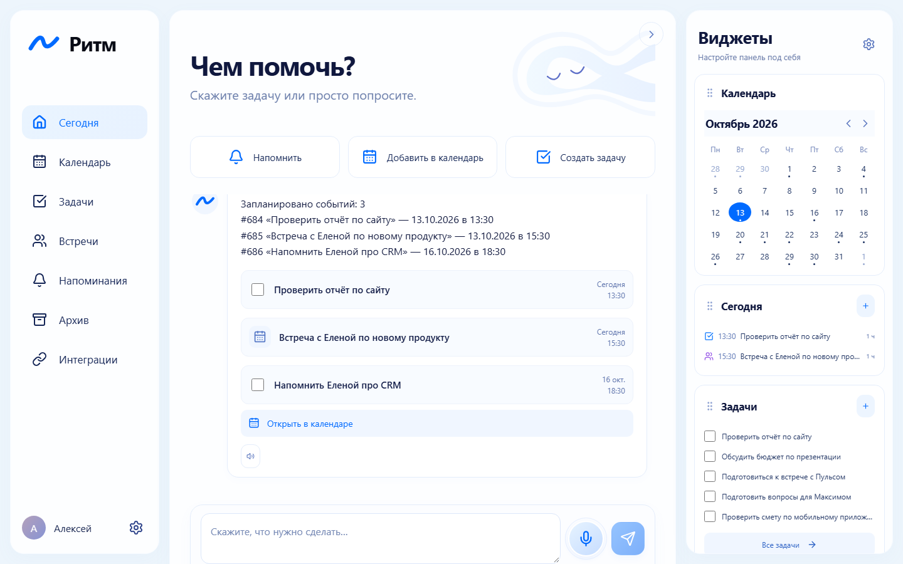
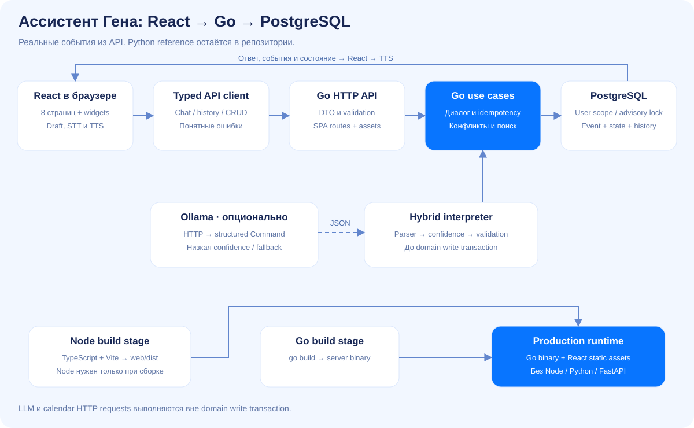
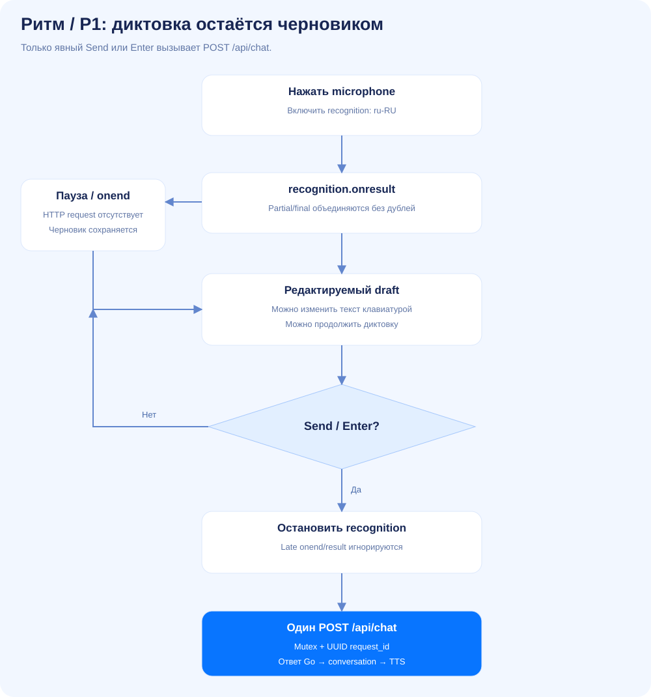

# Ритм — личный ассистент для задач и встреч

React / TypeScript / Vite + Go + SQLite. Голос или текст становятся редактируемым черновиком; сообщение отправляется **только по Send или Enter**. Пауза, onend и остановка microphone ничего не отправляют.



## Запуск

Нужен Docker Engine / Docker Desktop и Compose v2:

```bash
git clone https://github.com/NIDJEL/assistant-ai.git
cd assistant-ai
docker compose up --build -d
```

[Приложение — localhost:8081](http://localhost:8081), [OpenAPI](http://localhost:8081/docs), [блок-схемы](http://localhost:8081/architecture). Эти адреса работают на компьютере, где запущен сервер. Выбраны локальный запуск и Docker.

```bash
docker compose logs -f go-assistant
docker compose down
```

События и история сохраняются в томе `rhythm-go-data`. Runtime работает без root, Node, Python и FastAPI. Node нужен только на стадии build. Старый `docker compose -f compose.go.yaml up --build -d` также работает с тем же Go-томом и портом.

## Интерфейс

Сегодня: assistant, история, уточнения и карточки событий. Календарь: month/week/day, выбор даты и CRUD. Задачи: сроки, priority, поиск, завершение/возобновление. Встречи: duration, место, URL, перенос и конфликты. Напоминания: дата/время, edit/delete/complete. Архив: прошлые и выполненные записи, search/type/date/status filters. Настройки: имя, TTS и видимость виджетов.

Все даты и счётчики основаны на Go API. При первом старте импортируется предоставленный CSV из 1000 записей; повторный импорт не создаёт дубли. `AUTO_IMPORT_DEMO=false` отключает импорт для новой базы.

Яндекс Календарь показывает «Не подключён» и подготовленный UI P2. Google Calendar, Telegram, Zoom, Notion и Slack — «Скоро». Live CalDAV/OAuth остаются этапом P2. P1.1 добавляет визуальное выравнивание, подзадачи, участников встреч, inline-редактор напоминаний и draggable widgets с хранением настроек в SQLite. Приложение остаётся personal assistant.

## Голос

Microphone расположен справа перед Send. Partial/final transcript объединяются в draft, который можно редактировать. После паузы диктовка продолжается; после редактирования можно снова нажать microphone. Send останавливает recognition и отправляет один запрос. Enter отправляет, Shift+Enter переносит строку. Ошибки STT не отправляют текст; при сетевой ошибке chat черновик сохраняется, а повтор использует тот же request_id. Озвучивание ответов управляется в Settings.

Web Speech API требует поддержки браузера, разрешения microphone и обычно соединения с сервисом распознавания. При отсутствии поддержки работает текстовый ввод. Browser E2E использует контролируемый Speech mock с настоящим Go API; он проверяет UX и количество HTTP-запросов, а не качество живого распознавания.

## Разработка и проверки

Go 1.25+, Node 24, pnpm 11.25:

```bash
pnpm --dir web install --frozen-lockfile
pnpm --dir web build
go run ./cmd/server
```

По умолчанию Go использует отдельную `var/assistant-go.sqlite3`, порт 8081 и `.env`/переменные процесса. Для Vite hot reload Go запускается на 8082, затем `pnpm --dir web dev`. Подробная конфигурация и Windows-команды: [P1_UI.md](docs/P1_UI.md).

```bash
go test ./...
go vet ./...
go test -race ./...
pnpm --dir web test
pnpm --dir web build
pnpm --dir web exec playwright install chromium
pnpm --dir web e2e
```

На Windows без C compiler race tests выполняются в Linux Docker, как описано в [Go parity](docs/GO_PARITY.md). E2E использует отдельный сервер/базу на 8083. CI проверяет Go race на 1.25/1.27, frontend tests/build/E2E, оба Docker runtime и неизменённый Python corpus.

## Python reference и P0

`app/`, 73 Python-теста, 6 legacy voice-тестов и corpus сохранены на прежних местах. Запуск reference: `docker compose -f compose.python.yaml up --build -d` на 8000, со старым Python-томом. [Историческая инструкция](docs/PYTHON_REFERENCE.md).

```bash
python -m pytest -q
node --test tests/voice.test.js
```

SQLite настроен на WAL, busy_timeout=5000 и foreign_keys=1. Миграции создают согласованный backup и сохраняют ID/history/pending. Schema v3 добавляет место и URL встречи; v4 — метки, подзадачи, участников, состояние напоминаний и preferences. LLM HTTP выполняется вне короткой write transaction. Hybrid NLP и исходный общий corpus P0 сохранены.

## Документация

- [P1.1: visual alignment, REFERENCE / ACTUAL и проверки](docs/P1_1_DESIGN_PARITY.md)

- [P1: модули, runtime, ограничения и проверки](docs/P1_UI.md)
- [Desktop screenshots всех страниц, mobile и voice proof](docs/P1_SCREENSHOTS.md)
- [Implementation plan и baseline](docs/P1_IMPLEMENTATION.md)
- [Актуальный Go API](docs/API_CONTRACT_NEXT.md)
- [Go foundation и parity](docs/GO_PARITY.md)
- [Приоритеты P0–P4](docs/MIGRATION_PLAN.md)




