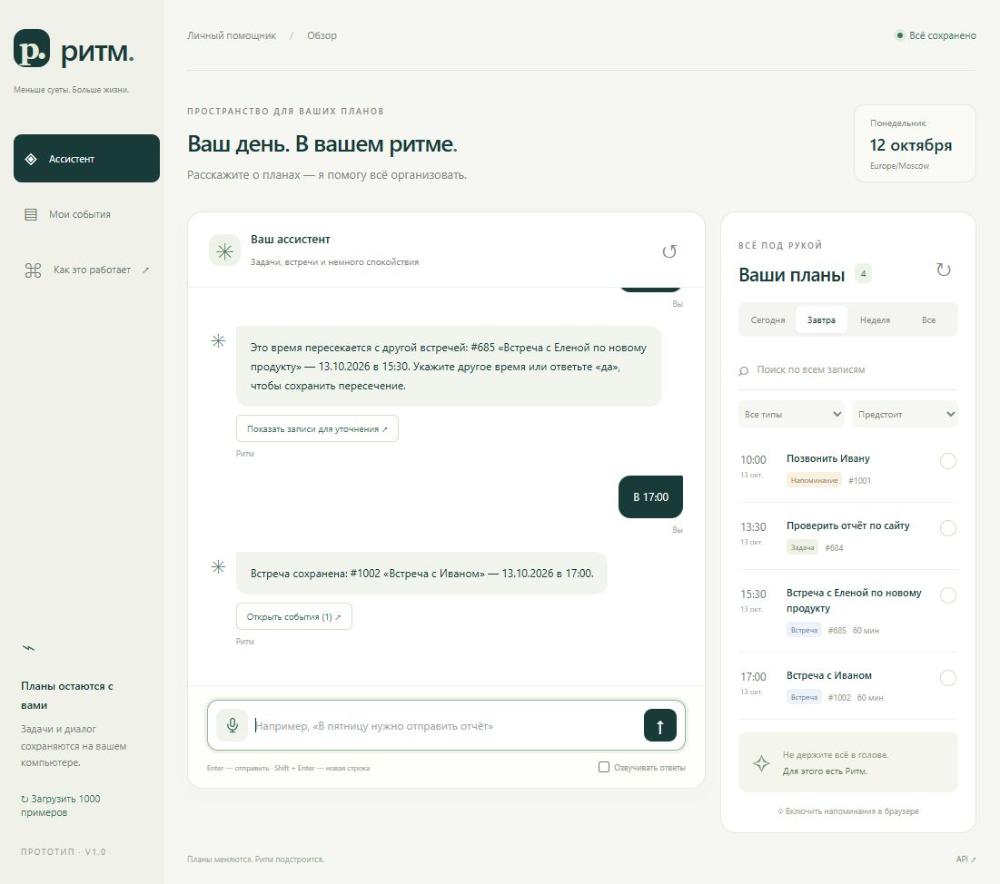

# Ритм — голосовой ассистент для задач и встреч

**Go migration P0:** добавлен отдельный Go backend с storage migration и общими parity tests. Запуск: `docker compose -f compose.go.yaml up --build -d`, адрес [localhost:8081](http://localhost:8081). Python-структура и текущий frontend сохранены. [Go foundation и проверки](docs/GO_PARITY.md), [приоритеты P0–P4](docs/MIGRATION_PLAN.md), [актуальный Go API](docs/API_CONTRACT_NEXT.md). Новый React/voice UX — следующий этап P1; live Яндекс CalDAV — P2.

Прототип личного планировщика на русском языке: создание задач, напоминаний и встреч, просмотр расписания и поиск по старым записям. Ввод голосом или текстом, ответ текстом и по желанию голосом.

**Работающий локальный прототип:** [http://localhost:8000](http://localhost:8000). **Блок-схемы:** [http://localhost:8000/architecture](http://localhost:8000/architecture). Эти ссылки работают на компьютере, где запущено приложение. Публичное размещение не выполнялось: выбран локальный запуск и Docker.



## Быстрый запуск

Нужен **Python 3.12+**. Для голоса рекомендуется актуальный Chrome или Edge. Для текстового режима не нужны API-ключи, модель или внешний сервер.

### Windows PowerShell

```powershell
git clone https://github.com/NIDJEL/assistant-ai.git
cd assistant-ai
python -m venv .venv
.\.venv\Scripts\python.exe -m pip install -r requirements.lock
.\.venv\Scripts\python.exe -m uvicorn app.main:app --host 127.0.0.1 --port 8000
```

Или из каталога проекта: `powershell -ExecutionPolicy Bypass -File .\start.ps1`. Скрипт создаёт окружение при необходимости, устанавливает зависимости и запускает сервер. Если `python` не найден, установите Python и включите добавление в PATH.

### Linux / macOS

```bash
git clone https://github.com/NIDJEL/assistant-ai.git
cd assistant-ai
python3 -m venv .venv
.venv/bin/python -m pip install -r requirements.lock
.venv/bin/python -m uvicorn app.main:app --host 127.0.0.1 --port 8000
```

Откройте [приложение](http://localhost:8000), [API](http://localhost:8000/docs) или [проверку состояния](http://localhost:8000/health).

### Docker

Нужен запущенный Docker Engine / Docker Desktop с поддержкой Linux-контейнеров и Compose v2.

```bash
docker compose up --build -d
docker compose logs -f assistant
```

Адрес: **http://localhost:8000**. Остановить: `docker compose down`. События и история сохраняются в томе `rhythm-data`, в том числе после пересоздания контейнера. `docker compose down -v` удаляет этот том и данные.

Контейнер работает без root, содержит healthcheck и использует закреплённые версии зависимостей. Порт Compose привязан к `127.0.0.1`. Проект рассчитан на одного пользователя; перед публичным размещением нужны HTTPS и аутентификация. Один экземпляр приложения / один Uvicorn worker — рекомендуемый режим для SQLite.

## Что попробовать

| Запрос | Результат |
| --- | --- |
| Напомни мне завтра в 10 утра позвонить Ивану | Напоминание с датой и временем |
| В пятницу нужно отправить отчёт | Задача на ближайшую пятницу, без выдуманного времени |
| Поставь задачу купить билеты до конца недели | Срок — воскресенье текущей недели |
| Добавь встречу с командой завтра в 15:00 | Встреча, по умолчанию на 60 минут |
| В четверг в 11 у меня встреча с дизайнером | Встреча на ближайший четверг |
| Что у меня сегодня? / Какие планы на сегодня? | Расписание на сегодня |
| Какие задачи у меня на завтра? | Только задачи на завтра |
| Что запланировано на следующей неделе? | Период с понедельника по воскресенье |
| Напомни через два часа проверить CRM | Дата и время относительно серверных часов |
| Найди задачу про презентацию | Поиск по всему архиву, включая завершённые записи |
| Когда у меня была встреча с Иваном? | Поиск встреч по имени, без ограничения будущим |
| Я когда-то ставил задачу по договору, найди её | Поиск старой задачи по теме |
| Найди задачу про контракт | Синоним «контракт» находит «договор» |

Уточняющий диалог:

```text
Вы: Поставь встречу с Иваном завтра
Ритм: На какое время поставить событие? Например, в 15:00.
Вы: В 15:00
Ритм: Встреча сохранена: #1001 «Встреча с Иваном» — [завтра] в 15:00.
Вы: А перенеси её на послезавтра
Ритм: Перенесено: #1001 ...
```

Если импортированный пример пересекается со встречей, ассистент предложит выбрать другое время или подтвердить пересечение. Для проверки без примеров задайте `AUTO_IMPORT_DEMO=false` до первого запуска с новой базой.

Дополнительно работают: `Перенеси задачу #42 на завтра`, `Отметь задачу #42 выполненной`, `Удали задачу #42`. Удаление выполняется только после ответа `да`; ответ `нет` или `отмена` отменяет ожидающее действие. При нескольких совпадениях ассистент предлагает номера записей. Контекст уточнения сохраняется между перезапусками и истекает через 30 минут.

### Голос и напоминания

Нажмите микрофон и произнесите запрос. После окончания речи **финальный** распознанный текст отправится ассистенту автоматически. Промежуточная расшифровка отображается в поле ввода. Ошибка микрофона или сети не запускает действие. Переключатель «Озвучивать ответы» включает Speech Synthesis с русским голосом, если он установлен в браузере/ОС.

Web Speech API зависит от браузера и его сервиса распознавания: обычно нужны интернет и разрешение микрофона. Аудио может передаваться провайдеру браузера; приложение не сохраняет аудио и не отправляет его на свой сервер. Используйте `localhost` или HTTPS: на обычном удалённом HTTP микрофон может быть недоступен. При отсутствии поддержки остаётся текстовый ввод. Реальное качество распознавания зависит от микрофона, языка и сети.

«Включить напоминания в браузере» запрашивает разрешение Notifications. Пока вкладка открыта и видима, приложение проверяет наступившие напоминания каждые 15 секунд. Окно доставки — 5 минут; повторное уведомление о той же версии события подавляется. Это **не** фоновый push-сервис: при закрытом браузере уведомления не приходят.

## CSV и хранение

В репозитории находится исходный `data/voice_assistant_events_1000.csv`: **1000 записей**, даты **07.01.2024–31.12.2027**, колонки `id,date,time,text`. Файл копируется без изменения содержания и импортируется при первом запуске. Повторный запуск или кнопка импорта не создают дубли.

```bash
python -m scripts.import_events
# или собственный CSV с той же схемой
python -m scripts.import_events /path/to/events.csv
```

Импорт проверяет весь файл до записи; некорректная строка не приводит к частичной загрузке. Уникальный ключ — имя файла + исходный id. Классификация CSV эвристическая: строки, начинающиеся с «Созвон», «Встреча», «Демо», «Совещание», «Интервью», считаются встречами; с «Напомнить» — напоминаниями; остальные — задачами. CSV не содержит длительности или статуса, поэтому используются 60 минут и `open`. Исходные даты сохраняются, прошлые записи доступны через поиск и фильтр «Все».

По умолчанию база — `var/assistant.sqlite3`. Есть тип, название, дата, время, длительность, статус, даты создания/изменения, ключ импорта. Дата задачи может отсутствовать; для встречи и напоминания дата и время обязательны. Диалоги отдельных вкладок разделяются `session_id`, но все события относятся к одному владельцу.

## Архитектура и решения


- **Python + FastAPI**: HTTP API, валидация Pydantic, статические файлы, документированный контракт.
- **Интерпретатор**: автономный русский NLP по умолчанию; опциональный адаптер локальной LLM через Ollama.
- **Бизнес-логика**: уточнения, контекст, выбор записи, пересечения интервалов встреч, подтверждение удаления.
- **SQLite**: WAL, индексы, параметризованные запросы, атомарное сохранение события, состояния и ответа.
- **Поиск**: pymorphy3 приводит русские слова к начальной форме; словарь синонимов объединяет близкие понятия; RapidFuzz учитывает опечатки; редкие термины имеют больший вес.
- **Frontend**: HTML/CSS/JavaScript без сборщика и CDN; адаптивный чат и список событий, Web Speech API и Notifications.

Подробнее: [все блок-схемы и описание](docs/ARCHITECTURE.md), [сценарий демонстрации](docs/DEMO.md), [проверки и ограничения](docs/VALIDATION.md).

### Опциональная LLM — Ollama

Базовый запуск не требует скачивания модели. Для более свободных формулировок можно подключить локальную модель:

```bash
ollama pull qwen2.5:7b
```

Скопируйте `.env.example` в `.env`, задайте `NLP_PROVIDER=ollama` и перезапустите приложение. Ollama должна быть запущена отдельно. Модель возвращает JSON по схеме `Command`; сервер проверяет поля и самостоятельно выполняет действие. Модель не получает доступ к SQL, файлам или произвольным инструментам. Явно распознанные дата/время имеют приоритет над арифметикой LLM. При таймауте, недоступности модели или некорректном JSON используется русский NLP; интерфейс помечает этот ответ «локальный режим».

Для Docker укажите в `.env` `OLLAMA_BASE_URL=http://host.docker.internal:11434`; для прямого Python-запуска — `http://127.0.0.1:11434`. Ollama на хосте должна принимать соединения из контейнера. Модель работает только при наличии подходящих ресурсов. Адаптер проверен тестами на контракт и отказ; реальная модель в текущем окружении не запускалась.

### Конфигурация

| Переменная | По умолчанию | Назначение |
| --- | --- | --- |
| APP_TIMEZONE | Europe/Moscow | Часовой пояс дат и времени |
| DATABASE_PATH | var/assistant.sqlite3 | Путь к базе |
| AUTO_IMPORT_DEMO | true | Идемпотентный импорт CSV при запуске |
| NLP_PROVIDER | rules | `rules` или `ollama` |
| OLLAMA_BASE_URL | http://127.0.0.1:11434 | Адрес локальной модели |
| OLLAMA_MODEL | qwen2.5:7b | Имя установленной модели |
| OLLAMA_TIMEOUT | 20 | Таймаут модели, секунды |

Периоды — `[start, end)`: правая граница не включается. Неделя начинается в понедельник. «В пятницу» означает ближайшую пятницу, включая сегодня; время без «утра/вечера» считается в 24-часовом формате. Дата без года — ближайшее будущее в текущем или следующем году. Прошлая явно указанная дата допускается с предупреждением. Длительность встречи по умолчанию 60 минут, пользователь может указать «на два часа» или «на 30 минут».

## Проверки

```bash
python -m pip install -r requirements-dev.txt
python -m pytest -q
python -m ruff check .
node --test tests/voice.test.js
```

Node.js 22+ нужен только для тестов голосового адаптера, не для запуска приложения. Проверяются обязательные фразы задания, даты и ошибки ввода, уточнения, поиск, CRUD, подтверждение удаления, конфликты (включая полночь и конкурентные запросы), повторная доставка, импорт 1000 строк, перезапуск, голосовые события и синтез. GitHub Actions дополнительно собирает Docker и делает HTTP smoke test контейнера.

Структура:

```text
app/
  main.py          # HTTP API и создание приложения
  schemas.py       # валидированный Command и входные запросы
  nlp.py, dates.py # русские намерения и даты
  llm.py           # сменный адаптер Ollama, отказ → NLP
  service.py       # бизнес-логика и уточняющий диалог
  repository.py    # SQLite, транзакции, импорт
  search.py        # морфология, синонимы, ранжирование
  static/         # интерфейс и отдельный голосовой адаптер
data/              # исходные 1000 событий
docs/              # архитектура, SVG, демонстрация, проверки
tests/             # Python и Node.js тесты
scripts/           # импорт, генерация SVG, lock зависимостей
```

## Ограничения и дальнейшие улучшения

Автономный интерпретатор покрывает распространённые русские формулировки и все основные сценарии задания; он не является универсальной языковой моделью. Неизвестный запрос приводит к подсказке или уточнению. Поиск морфологический со словарём синонимов, **не векторный**: для произвольной семантики следующим шагом добавил бы multilingual embeddings и оценку релевантности на размеченном наборе запросов.

Также улучшил бы: фоновые напоминания через отдельный scheduler и push, повторяющиеся события, OAuth-интеграцию календарей, аутентификацию и владельца каждой записи, управляемое удаление истории и резервное копирование, серверное STT для браузеров без Web Speech, потоковый ответ LLM. Сейчас эти функции не заявляются реализованными. Интерфейс одноязычный, приложение однопользовательское, внешняя LLM опциональна.

При разработке использовались AI-инструменты. Архитектурные решения и проверенные ограничения описаны явно, чтобы прототип было удобно оценить и развивать.

Ссылки на первичные технические источники: [FastAPI / Docker](https://fastapi.tiangolo.com/deployment/docker/), [Web Speech API](https://developer.mozilla.org/en-US/docs/Web/API/Web_Speech_API), [Ollama API](https://docs.ollama.com/api).
