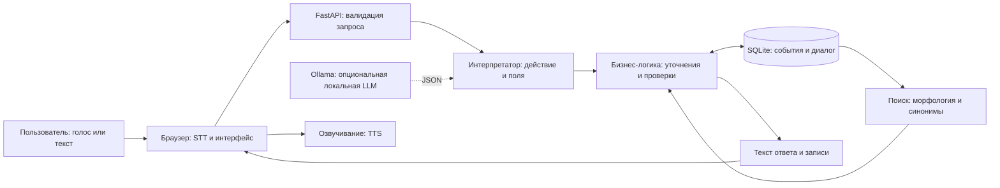
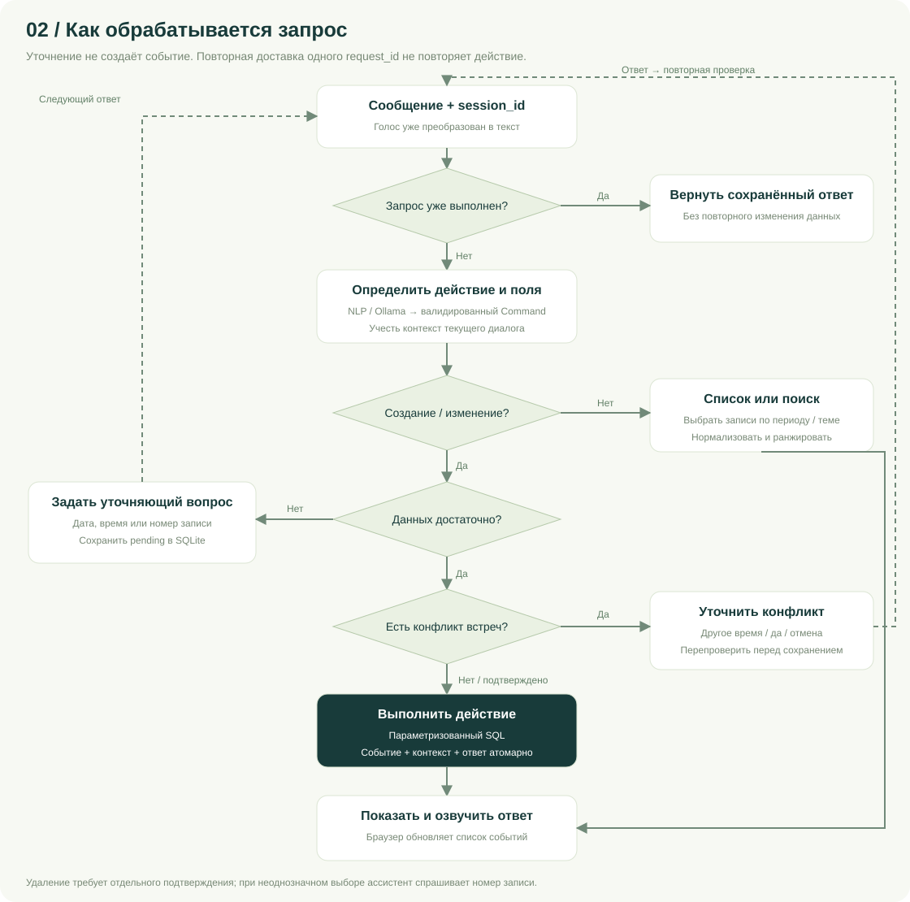
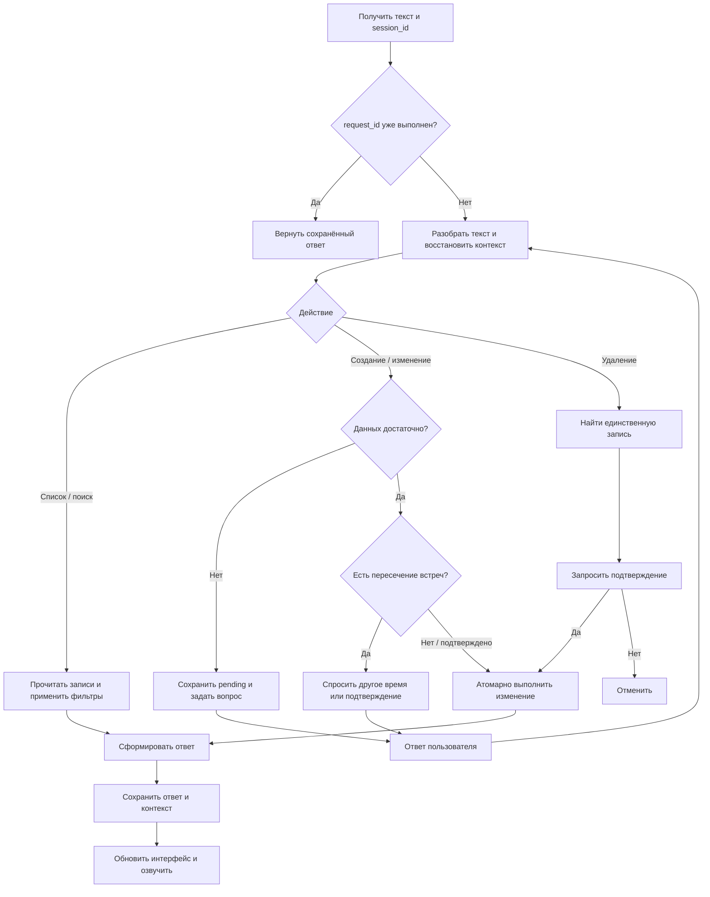
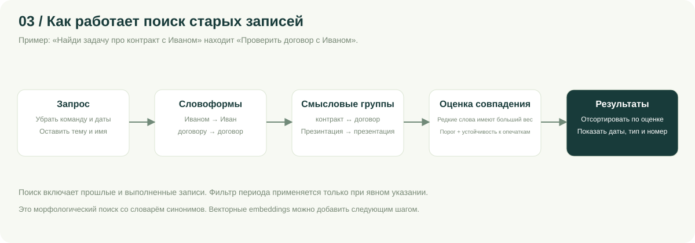
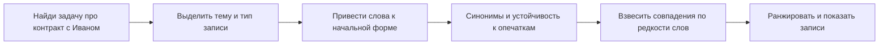
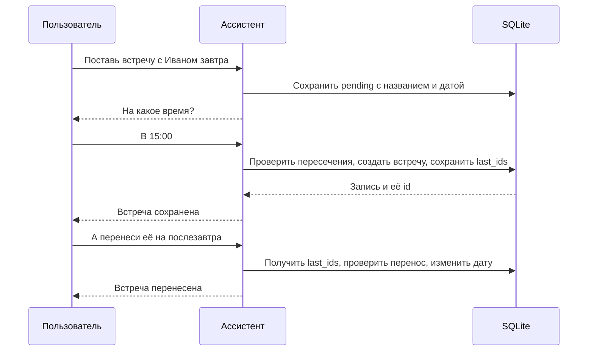
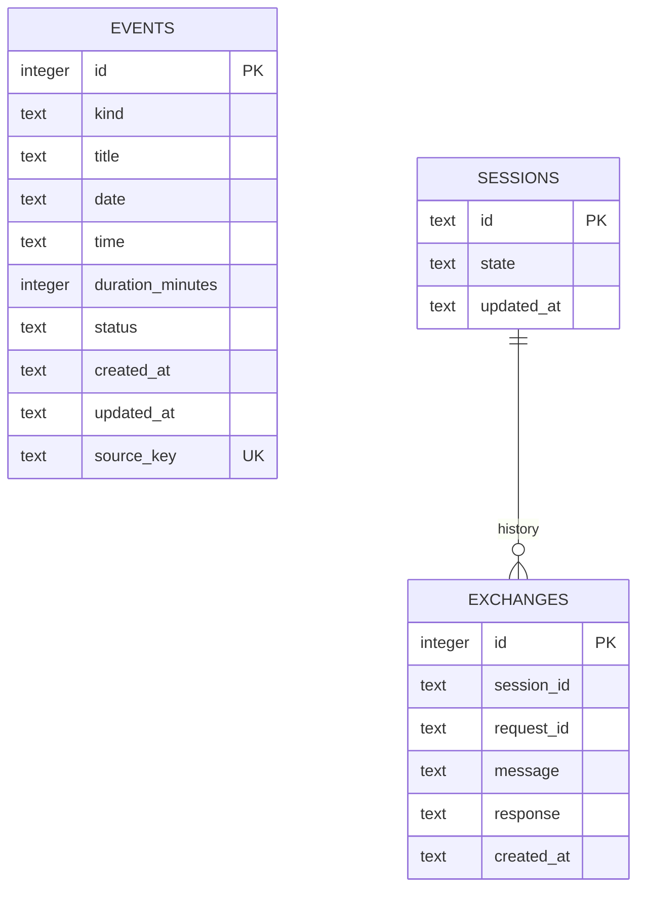

# Блок-схемы и архитектура Гена

Схемы доступны в браузере по `/architecture` и как SVG без внешних зависимостей. Их можно увеличить, распечатать или включить в презентацию. Mermaid ниже отображается непосредственно на GitHub. Генератор SVG: `python scripts/build_diagrams.py`.

## Актуальный runtime

React/TypeScript → Go HTTP/typed DTO → deterministic NLU → assistant/calendar services → repository → PostgreSQL. Email/Яндекс ID используют server-side sessions и PKCE. SQLite и Python ниже — сохранённый reference/parity слой, а не production runtime. Calendar outbox синхронизируется существующим worker вне domain write transaction.

Structured recurrence находится в events.details и Command/pending. Due выполняет короткую транзакцию пользователя, сохраняет следующий occurrence и replay последнего сигнала. UI polling остаётся транспортом уведомлений; отдельного reminder worker нет. Подробности: [RUSSIAN_NLU.md](RUSSIAN_NLU.md), [auth](P1_2_AUTH_POSTGRES.md). Новая migration 003 удаляет retired OAuth provider; прежние migrations не менялись.

## 1. Reference-архитектура

Голосовой слой не меняет базу. Speech-to-Text возвращает обычный текст, который идёт через тот же API, что и ручной ввод. `Command` — контракт между интерпретатором и сервисом; любое изменение выполняет сервис после проверок. Время берётся с сервера в настроенном часовом поясе. В тестах часы фиксированы для воспроизводимости.

## 2. Обработка запроса

`BEGIN IMMEDIATE` сериализует запись. Проверка пересечения и создание/перенос входят в одну транзакцию: два параллельных запроса на один интервал не создают незамеченный конфликт. Пересечение определяется условием `start < other_end AND other_start < end`; соседние интервалы разрешены. Учитываются длительности и переход через полночь, закрытые встречи исключаются.

Пара `(session_id, request_id)` уникальна в `exchanges`. Повторный запрос с тем же идентификатором возвращает сохранённый результат. Другой текст под тем же идентификатором отклоняется. Событие, состояние и ответ сохраняются вместе; при исключении транзакция откатывается.

## 3. Поиск

Пример: «Иваном» → «Иван», «контракт» ↔ «договор». Поиск не ограничивается будущим и включает выполненные записи. Ранжирование — взвешенное покрытие токенов запроса, с порогом релевантности и fuzzy-похожестью. Поиск по 1000 строкам выполняется в памяти; нормализация кэшируется. Для большого архива можно перейти к FTS/векторному индексу, сохранив сервисный контракт.

## 4. Уточняющий диалог

В `sessions.state` хранятся `pending` и `last_ids`. Возможные ожидания: недостающие поля, номер подходящей записи, подтверждение удаления, подтверждение конфликта. В ожидании уточнения дата/время дополняются без потери ранее собранных полей. Новый явно сформулированный запрос заменяет ожидание; «отмена» очищает его. Несколько найденных записей никогда не изменяются автоматически по местоимению.

## Модель данных

Связь сессии с историей логическая; внешнего ключа нет, поскольку параллельно создаваемая сессия сохраняется в той же транзакции. События принадлежат одному владельцу и доступны всем его диалогам. SQLite-файл и WAL следует резервировать через SQLite backup API или при остановленном сервере.

## HTTP-контракт

| Метод | Путь | Назначение |
| --- | --- | --- |
| POST | `/api/chat` | Текст, UUID сессии и запроса → ответ, действие, записи, ожидание |
| GET | `/api/history/{session_id}` | Последние 50 обменов и состояние сессии |
| GET | `/api/events` | `start`, `end`, `kind`, `status`, `q`, `offset`, `limit` |
| PATCH | `/api/events/{id}` | Переключить `open` / `done` |
| POST | `/api/import-demo` | Импорт встроенного CSV без дублей |
| GET | `/api/reminders/due` | Напоминания, наступившие не более 5 минут назад |
| GET | `/health` | Доступность БД, число событий, часовой пояс и часы |

Полный OpenAPI доступен по `/docs`. Ошибки входных данных возвращают 422, отсутствующая запись — 404. HTML интерфейс использует `textContent` для сообщений и названий; пользовательский текст не интерпретируется как HTML.
