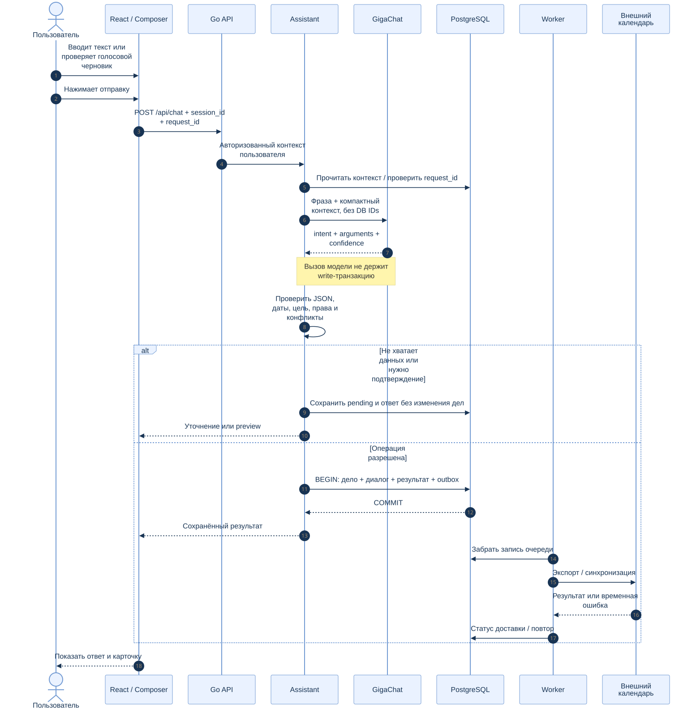

# Архитектура

[Документация](README.md) · [Материалы для организаторов](../SUBMISSION.md)

## Система целиком


Гена — модульный монолит: React/TypeScript в браузере и один Go-процесс для API, ассистента и workers. PostgreSQL — обязательное рабочее хранилище. Node.js нужен для сборки/разработки, но отсутствует в runtime-образе. SQLite оставлена для явного импорта старой базы и регрессионных тестов.

В production Nginx завершает HTTPS, ограничивает запросы и проксирует к loopback-порту контейнера. Самостоятельные HTML-страницы ошибок размещены на хосте и доступны даже при недоступном Go backend. Локальный launcher запускает app и PostgreSQL; браузер обращается прямо к Go по HTTP на localhost.

## Компоненты



| Модуль | Ответственность |
| --- | --- |
| `internal/api`, `auth` | HTTP-контракт, вход, сессии, CSRF, доступ и лимиты. |
| `assistant`, `nlu`, `llm` | Компактный контекст, типизированная операция, уточнения, выбор и подтверждения; единственный внешний текстовый провайдер — GigaChat. |
| `calendar`, `search` | Даты, конфликты, CRUD, CSV, русская нормализация и нечёткий поиск. |
| `social`, `integrations` | Друзья, совместные встречи, OAuth, очереди календарей и Zoom. |
| `repository`, `storage/postgres` | Область пользователя, SQL и транзакции; миграции встроены в binary. |
| `notifications` | Напоминания, повторения, occurrence/delivery и Web Push. |
| `stt`, `tts` | Изолированные серверные клиенты Groq и Azure. |

## UML: основные зависимости



Схема показывает существенные интерфейсы и связи, а не полный набор полей и сигнатур Go. `assistant.Service` использует интерпретатор и исполнитель; `llm.Simple` получает `Operation` от GigaChat; `calendar.Service` и контекст диалога сохраняются через `repository.Store`. Рабочая реализация — PostgreSQL.

## UML: выполнение команды



1. API устанавливает пользователя и проверяет запрос.
2. Ассистент получает state и проверяет идемпотентный `request_id`.
3. GigaChat получает текст и ограниченный контекст без DB IDs. Вызов выполняется вне write-транзакции.
4. Go строго декодирует JSON, вычисляет даты, разрешает ссылки только на записи пользователя, проверяет права/конфликты.
5. Уточнение или preview не изменяют дела. Разрешённая операция сохраняет дело, state, ответ и outbox транзакционно.
6. Workers вызывают внешние API вне этой транзакции, сохраняют результаты и повторы.

[Подробный контракт](SIMPLE_LLM_RUNTIME.md) · [Поведение диалога](ASSISTANT_BEHAVIOR.md).

## UML: состояния диалога



Для удаления и batch показывается конкретный snapshot. Подтверждение не присоединяет к нему новые записи; устаревшие данные и конфликт проверяются повторно. Ошибка откатывает транзакцию. Это диаграмма жизненного цикла операции, а не список всех внутренних состояний совместного планирования.

## Данные и изоляция



ER-диаграмма намеренно сокращена: в ней основные таблицы и связи. Линии включают логические связи приложения: например, `cloud_event_links.event_id` намеренно не имеет FK, чтобы worker мог удалить внешнее событие после локального удаления. Полный DDL — [SQL-миграции](../internal/storage/postgres/migrations/), включая legal acceptance, outbox, friend requests и переносы.

`user_id` задаёт область записей, диалогов, настроек и интеграций. Сессии и OAuth state имеют срок действия; внешние OAuth-токены шифруются. [Подробности](ACCOUNTS.md). Версия схемы из `/health` не равна количеству SQL-файлов; ориентируйтесь на миграции и контракт API.

## Голос



Запись идёт через `getUserMedia/MediaRecorder`. Groq возвращает черновик; остановка микрофона ничего не отправляет в чат. После проверки пользователь нажимает отправку. Azure TTS вызывается отдельно для воспроизведения ответа. Голосовые ключи находятся только на backend; аудио STT обрабатывается в памяти.

## Внешние интеграции

| Интеграция | Направление / поведение |
| --- | --- |
| Яндекс | Гена → Яндекс Календарь, CalDAV и отдельная outbox. |
| Google | Экспорт дел и импорт внешних событий, выбранный пользователем календарь. |
| Zoom | Создание по явной просьбе, сохранение meeting ID/join URL, обновление связанной конференции. |
| Web Push | Серверная очередь доставок на разрешённые подписки устройств. |

Точная семантика повтора, согласий и конфликтов: [Google/Zoom](GOOGLE_CALENDAR_ZOOM.md), [Яндекс](YANDEX_CALENDAR.md), [Web Push](WEB_PUSH.md).

## Развёртывание



Локальный [launcher](../scripts/service.py) создаёт env и постоянные ключи, собирает исходники в Docker, запускает PostgreSQL/app и проверяет health. В production CI собирает приложение один раз и передаёт готовый архив по ограниченному SSH-каналу. Receiver валидирует архив, делает и проверяет backup, обновляет только app, проверяет HTTPS и переключает symlink. Откат приложения не отменяет SQL-миграции.

[CI/CD](../deploy/CI_CD.md) · [Эксплуатация](../deploy/README.md).

## Источники и обновление схем

Каждый SVG имеет одноимённый `.mmd` в [diagrams](diagrams/). Рендер выполняется закреплённой Mermaid CLI 12.0.0:

```bash
python scripts/render_diagrams.py
```

Нужны Node.js 24 и npm/npx; они требуются только для регенерации схем. Можно передать `--browser /path/to/chrome` и имена отдельных диаграмм. Для запуска сервиса готовых SVG достаточно. HTML-галерея доступна локально по `/architecture` и не требует внешнего CDN.
