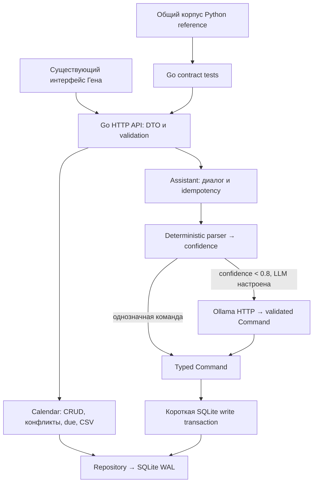
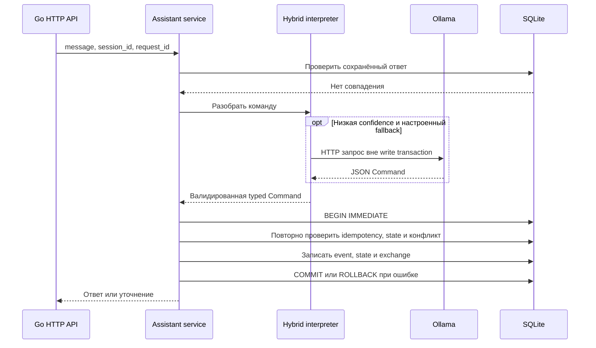

# P0: Go foundation, SQLite migration и backend parity

> Завершённый этап P0. Текущий React frontend и runtime P1: [P1_UI.md](P1_UI.md). Основной Dockerfile теперь собирает React + Go; Python reference использует Dockerfile.python. В P1 schema v3 добавляет только location/meeting_url.

Этот этап добавляет Go backend рядом с текущим Python. Каталоги `app/`, Python-тесты, старый Dockerfile и Compose сохранены. React, исправление voice UX и внешние интеграции относятся к следующим этапам.

## Блок-схема P0





При повторном request_id возвращается сохранённый ответ без нового вызова LLM и изменения event. Внешние calendar requests появятся только в P2 и будут выполняться до или после короткой транзакции.

## Запуск Go

Go 1.26+ (production toolchain: Go 1.27.2):

```powershell
# Отдельная база для сравнения с Python
$env:DATABASE_PATH = 'var/assistant-go.sqlite3'
$env:APP_ADDR = '127.0.0.1:8081'
go run ./cmd/server
```

```bash
DATABASE_PATH=var/assistant-go.sqlite3 APP_ADDR=127.0.0.1:8081 go run ./cmd/server
```

Интерфейс: http://localhost:8081. Health: http://localhost:8081/health. OpenAPI: http://localhost:8081/openapi.json, Swagger: http://localhost:8081/docs.

Go отдаёт существующий frontend. Голосовой UX на P0 сохраняет прежнее поведение; ручная отправка диктовки будет реализована в P1.

## Отдельный Docker runtime

```bash
docker compose -f compose.go.yaml up --build -d
docker compose -f compose.go.yaml logs -f go-assistant
docker compose -f compose.go.yaml down
```

Порт 8081, том `rhythm-go-data`, Go binary и существующие static assets. Runtime не содержит Python/FastAPI и работает с UID 65532. Старый `compose.yaml` остаётся доступен для Python reference. Базы и тома этих двух серверов разделены; они не должны писать в один файл SQLite.

## Конфигурация

Go читает `.env` из APP_ROOT; переменные процесса имеют приоритет. `.env.go.example` содержит значения для отдельного Go-запуска. Не заменяйте DATABASE_PATH рабочей Python-базой для обычного сравнения.

| Параметр | По умолчанию |
| --- | --- |
| APP_ADDR | 127.0.0.1:8081 |
| APP_ROOT | текущий каталог |
| DATABASE_PATH | var/assistant-go.sqlite3 |
| APP_TIMEZONE | Europe/Moscow |
| AUTO_IMPORT_DEMO | true |
| NLP_PROVIDER | rules |
| OLLAMA_BASE_URL | http://127.0.0.1:11434 |
| OLLAMA_MODEL | qwen2.5:7b |
| OLLAMA_TIMEOUT | 20 секунд |

В `rules` работает deterministic parser. `ollama` или `hybrid` включают LLM fallback при confidence < 0.8. Однозначные команды, ошибки дат и ответы на уточнения обрабатываются локально. LLM возвращает только валидированный Command. Она не получает SQL/repository.

## Storage и миграции

- `database/sql` + modernc SQLite 1.59.0, совместимый с Go 1.25.
- На каждом соединении: WAL, busy_timeout=5000, foreign_keys=1. Пул ограничен четырьмя соединениями.
- Read-запросы не открывают write transaction. Write scope использует выделенное соединение и `BEGIN IMMEDIATE`, commit/rollback, context-aware очередь записи.
- Вызов LLM выполняется до write scope. Сетевые calendar requests пока отсутствуют и в P2 также будут выполняться вне write transaction.
- State, event и exchange сохраняются атомарно; уникальный session_id/request_id предотвращает повторное выполнение.
- `001_base.sql` совместим с Python schema v1. `002_event_metadata.sql` добавляет description, priority и external_calendar_id без изменения ID и исходных записей.
- Перед миграцией существующей базы создаётся `*.backup-<timestamp>.sqlite3` через SQLite VACUUM INTO: копия включает committed WAL. Ошибка backup останавливает миграцию.
- Миграции выполняются одной транзакцией и учитываются в schema_migrations. Повторный запуск не выполняет их снова. Неизвестная будущая schema version отклоняется.
- Отмена контекста и ошибка callback откатывают изменения. Rollback получает отдельный короткий cleanup context.

Для проверки своей старой базы сначала создайте согласованную копию через SQLite backup API, запускайте Go на копии и сверяйте данные. В рамках разработки рабочая `var/assistant.sqlite3` не мигрировалась.

## Общий corpus

`scripts/export_parity.py` использует неизменённый Python reference и создаёт:

- 32 temporal cases из существующих тестов;
- 14 command cases из существующих формулировок;
- 20 последовательных HTTP-сценариев (84 шага): создание, поиск, уточнение, перенос, завершение, удаление, конфликт, полночь, импорт, validation, restart, history, expiry;
- синтетическую legacy_v1.sqlite3: 1000 CSV-записей, дополнительная задача, история и pending настоящего Python-сервиса;
- словарь 2394 словоформ для нормализации корпуса/CSV и их склонений.

Go contract tests читают тот же corpus и сравнивают существующие поля ответа, HTTP-коды, порядок/оценки поиска и состояние диалога. Новые дополнительные DTO-поля допускаются. Контракт idempotency сохраняет прежний 422 для другого текста под уже использованным request_id.

В Go уточнения выбора теперь предлагают название, дату и время вместо обязательного номера. Два изменённых текста явно сопоставлены в `currentDialogueCopy` контрактного теста, включая историю; исходный Python corpus сохранён. Новые сценарии выбора и безопасного группового удаления проверяются отдельно.

Нормализация словоформ использует экспортированные леммы pymorphy3/OpenCorpora; неизвестные слова — Unicode Russian Snowball stemmer. Это не полный OpenCorpora analyzer для любого русского слова. Поиск проверяется на падежах, именах, синонимах, опечатках и description. ASCII word boundaries не используются для русских команд.

## Проверки

```bash
go test ./...
go vet ./...
go test -race ./...
python -m pytest -q
node --test tests/voice.test.js
```

Для Windows без C compiler race detector запускается в Linux Docker:

```powershell
docker run --rm --mount "type=bind,source=$($PWD.Path),target=/workspace" --workdir /workspace golang:1.27.2-bookworm go test -race ./...
```

Дополнительные тесты проверяют PRAGMA на каждом соединении, foreign keys, rollback/cancellation, backup и миграцию v1, ошибку миграции, concurrent create/idempotency/search, HTTP CRUD/error DTO, LLM schema validation/cancellation и доступность SQLite writer во время заблокированного реального HTTP-запроса к тестовой Ollama.

Перегенерация corpus/словаря нужна только при изменении reference или расширении сценариев. Python не нужен для Go startup или Go tests: результаты экспорта уже включены в репозиторий.

## Границы P0

Приложение остаётся personal assistant. Workspace/team/auth/permissions и assignee не добавлены. React frontend, новый voice UX, live Yandex CalDAV, Google dev-provider, draggable widgets и расширенные возможности здесь не реализуются. Telegram/Zoom/Notion/Slack в дальнейшем показываются только как «Скоро».
