# Ритм P1 — desktop 1440×900

Снимки сделаны browser E2E с production React build и реальным Go API. Данные — импортированный CSV, текущая дата — Go health. Они не являются статическим frontend или mocked event fixtures.

## Сегодня

## Календарь

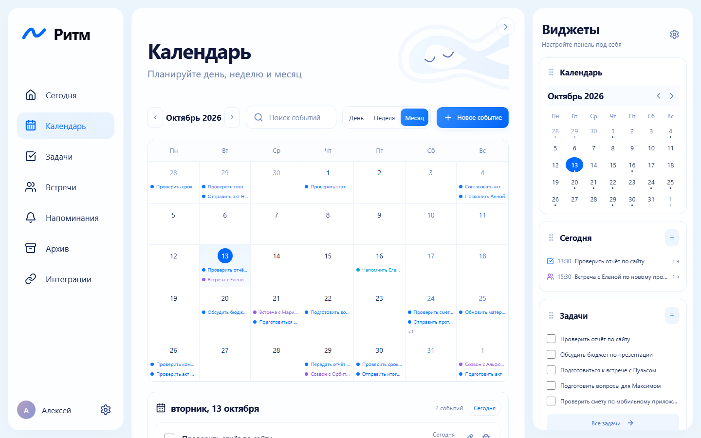

## Задачи

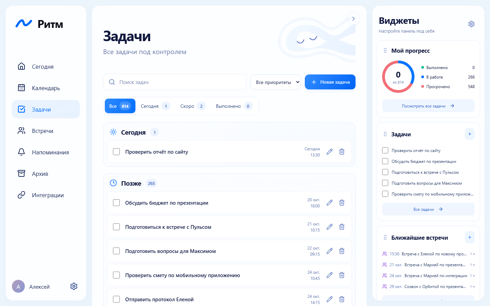

## Встречи

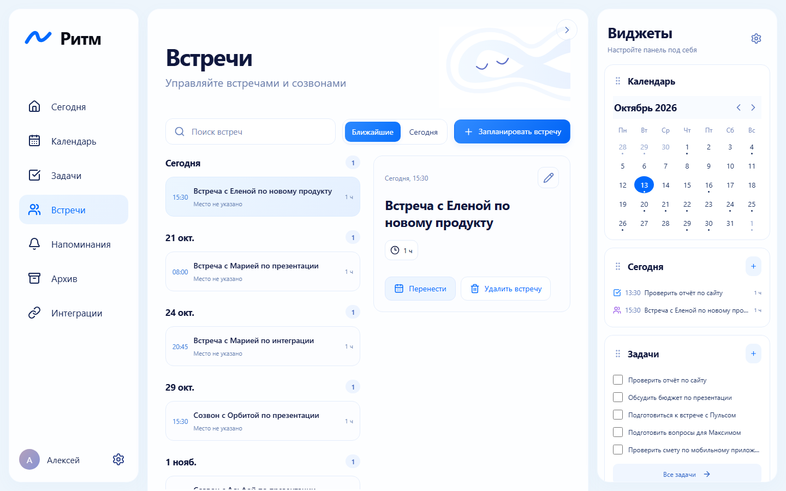

## Напоминания

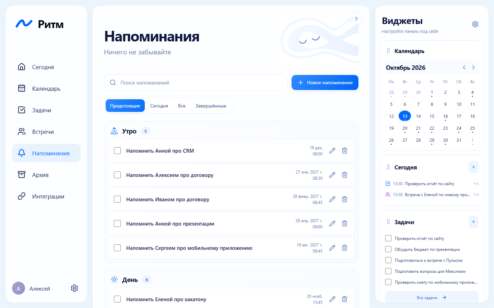

## Архив

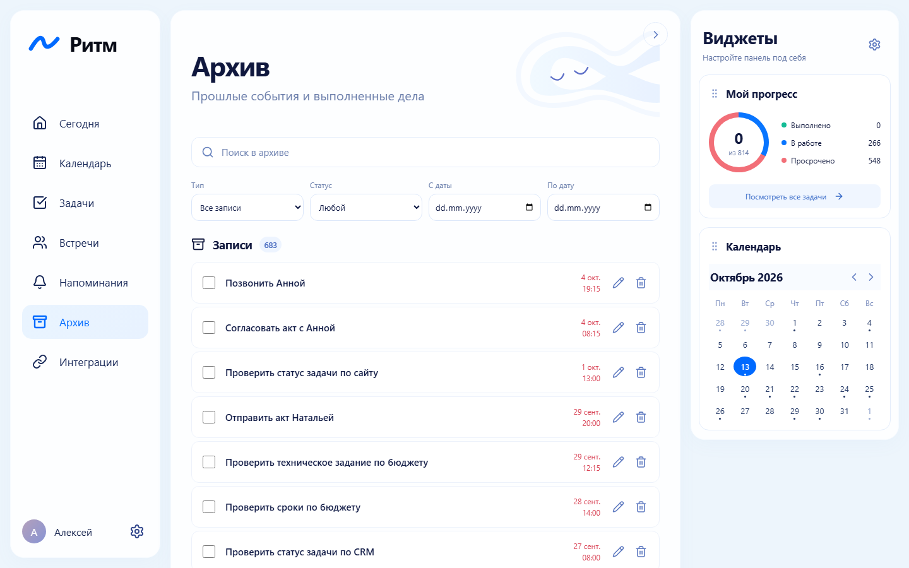

## Интеграции

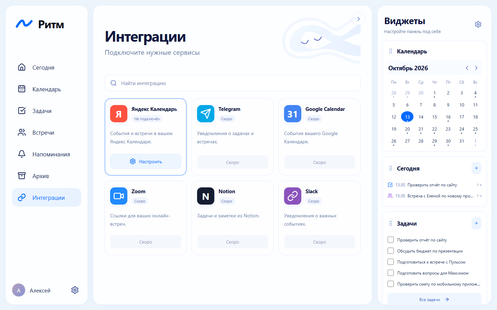

## Настройки

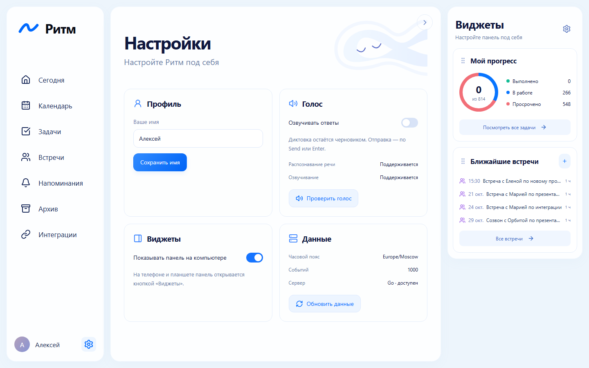

## Mobile 390×844

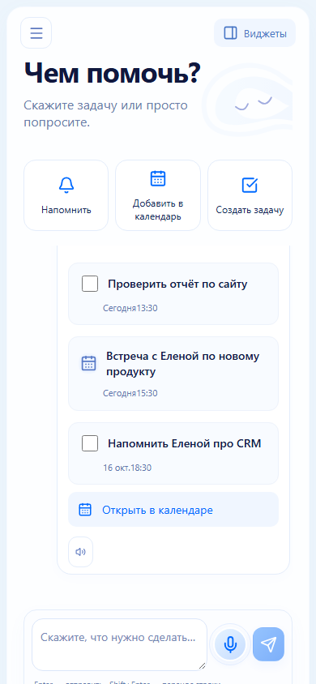

## Конфликт встречи

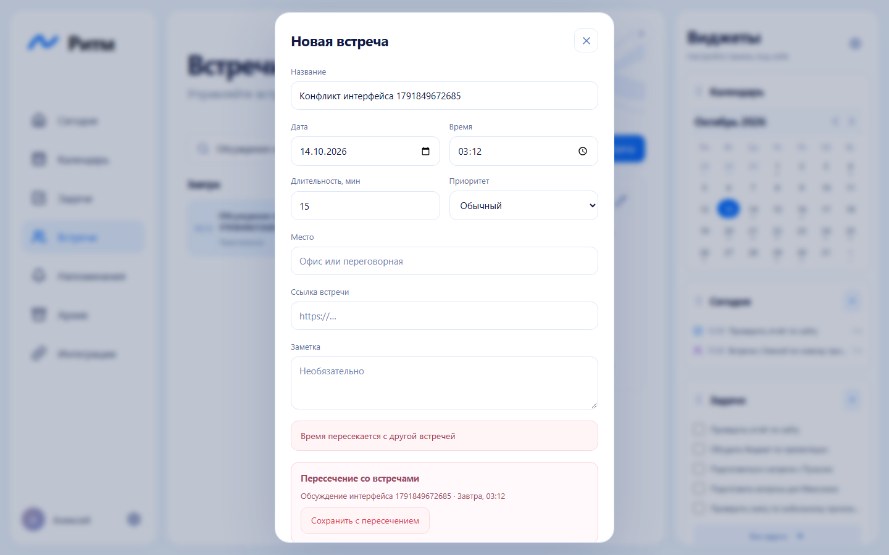

## Voice proof

Контролируемый Web Speech mock, реальный React UI и Go HTTP. Проверено: после паузы 700 мс — 0 POST; после продолжения — 0 POST; после Send и late onend — ровно 1 POST. Recognition остановлен один раз. [Машинный результат](screenshots/p1/voice-proof.json).

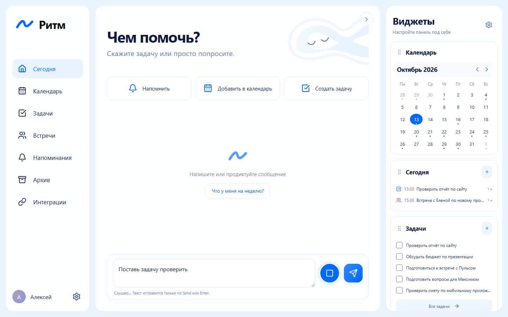

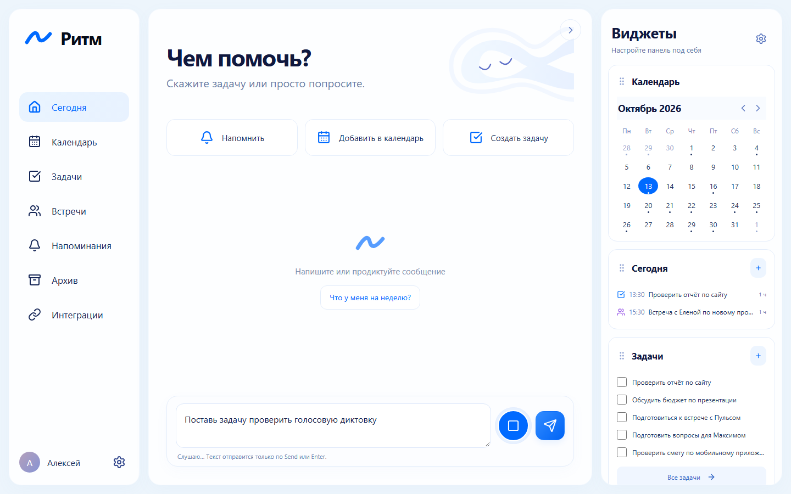

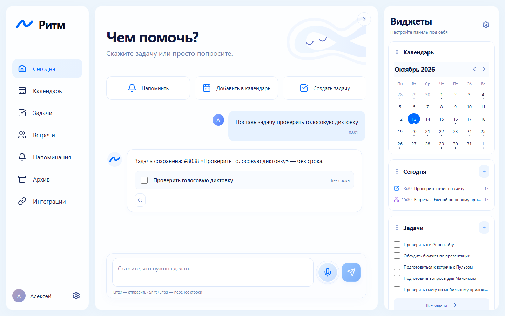
