# Web Push и PWA Ассистента Гены

[← Документация](README.md)

Гена обрабатывает сроки на сервере независимо от открытых вкладок. Системные уведомления требуют настроенного сервера, разрешения пользователя и активной подписки конкретного устройства. Без подписки остаются уведомления внутри открытого приложения.

## Архитектура

```mermaid
flowchart LR
    Event[Задача / встреча / напоминание] --> PG[(PostgreSQL)]
    PG --> Scheduler[Серверный планировщик]
    Scheduler --> Occurrence[Уникальный occurrence и снимок]
    Occurrence --> Devices[Доставка на каждое активное устройство]
    Devices --> Sender[Web Push / VAPID]
    Sender --> Provider[Служба браузера]
    Provider --> SW[notifications-sw.js]
    SW --> Notice[Системное уведомление Гены]
    Notice --> App[Календарь и редактор события]
```



`internal/notifications` содержит модель, проверку подписки, отправитель и worker. `internal/storage/postgres/notifications.go` реализует транзакции и очередь. Worker встроен в Go-процесс; отдельный микросервис не нужен. Два цикла, планирование и доставка, запускаются вместе с сервером и завершаются по его context. Медленный HTTP endpoint не задерживает следующий проход планировщика. Интервал проходов — 5 секунд; доставка обрабатывает до 100 записей за проход, каждый HTTP-вызов ограничен временем.

Планировщик выбирает наступившие записи и получает `pg_try_advisory_xact_lock(hashtextextended(user_id,0))`, тот же PostgreSQL lock, который используется редактированием дел. Он повторно читает актуальные данные внутри транзакции, сохраняет occurrence, доставки и следующий момент повторения одним commit. Второй экземпляр пропускает занятый аккаунт. Отправители получают `FOR UPDATE OF d,s SKIP LOCKED`; блокировка доставки/устройства удерживается до сохранения результата ограниченного HTTP-вызова.

`GET /api/reminders/due` в production только читает последние сохранённые снимки. Он не отправляет push и не продвигает recurrence. React опрашивает этот endpoint для уведомлений внутри видимой страницы; polling не вызывает системное уведомление. Сохранённый SQLite Due используется для совместимости и тестов, не рабочим сервером.

## База данных

Миграция `internal/storage/postgres/migrations/004_web_push.sql` выполняется при запуске вместе с существующими миграциями под database advisory lock.

| Таблица | Назначение |
| --- | --- |
| `push_subscriptions` | Устройство пользователя: UUID, уникальный endpoint, p256dh/auth, платформа/user-agent, времена создания/изменения/успеха/ошибки, счётчик ошибок и disabled_at. |
| `notification_occurrences` | UUID уведомления, пользователь, event_id, точный UTC occurrence, payload, снимок записи, время создания и expiration. `UNIQUE(event_id,occurrence_at)`. Тестовые уведомления имеют event_id=NULL. |
| `notification_deliveries` | Отдельная запись на устройство, канал web_push, status, attempts, next_attempt_at, updated_at, HTTP status. `UNIQUE(notification_id,subscription_id)`. Составные FK гарантируют совпадение владельцев occurrence и устройства. |
| `push_test_limits` | Общий для всех экземпляров cooldown проверки: один запрос на пользователя в минуту. |

`oauth_states.source` хранит whitelist `onboarding` / `integrations`, вместе с существующими purpose, PKCE и одноразовым browser-bound state. Произвольных return URL нет.

Один аккаунт может иметь до 20 активных устройств. Повторная регистрация того же endpoint возвращает прежний UUID; устройство другого пользователя не присваивается. Список устройств не раскрывает endpoint и ключи. Отключение сохраняет диагностические данные, прекращает новые доставки и отменяет ожидающие. Резервная копия PostgreSQL включает всю очередь. Очистка истории пока не автоматизирована.

## Настройка VAPID

```sh
go run ./cmd/web-push-keys
```

Команда печатает новую пару для настройки серверных secrets. Запустите её один раз для установки и сохраните оба значения между перезапусками. Приватный ключ не должен попадать в публичные файлы, frontend, логи или Git.

```dotenv
WEB_PUSH_VAPID_PUBLIC_KEY=<public key>
WEB_PUSH_VAPID_PRIVATE_KEY=<private key>
WEB_PUSH_SUBJECT=mailto:operator@example.com
```

Допустим также HTTPS URL контакта оператора. Backend проверяет P-256-пару и subject при запуске. Частично заполненная или несовпадающая конфигурация отклоняется без печати ключей. Все три пустые переменные выключают отправитель, сохраняя серверное планирование и in-app fallback. Frontend получает только public key и enabled.

Шифрование payload и подпись VAPID выполняет [webpush-go v1.4.0](https://github.com/SherClockHolmes/webpush-go). Собственной реализации Web Push encryption нет. HTTP-клиент не следует redirects, отключает proxy из окружения, проверяет DNS-адреса при соединении и запрещает внутренние/локальные сети. В журнал не попадают endpoint, auth, p256dh или текст ошибок транспорта с URL.

## API

Все endpoints требуют текущую cookie-сессию; изменения используют существующую same-origin JSON/CSRF-защиту. Полный контракт есть в `/openapi.json`.

| Метод и путь | Результат |
| --- | --- |
| `GET /api/notifications/push/config` | `{enabled, public_key}`. |
| `GET /api/notifications/push/subscriptions` | Только устройства текущего аккаунта, без ключей. |
| `POST /api/notifications/push/subscriptions` | `{endpoint, keys:{p256dh,auth}, platform}` → 201 и безопасная модель устройства. |
| `DELETE /api/notifications/push/subscriptions/{id}` | Отключение собственного устройства → 204; чужой UUID → 404. |
| `POST /api/notifications/push/test` | `{subscription_id}` → 202; UUID должен принадлежать активному устройству пользователя. |

Проверка использует ту же PostgreSQL очередь, sender и service worker: **Гена / Уведомления работают**. Endpoint возвращает факт постановки в очередь. Повтор раньше минуты возвращает 429/Retry-After; cooldown сохраняется после restart.

Payload содержит notification_id, user_id, event_id, title, body, url, kind, timestamp и expires_at. Для события URL — `/calendar?date=YYYY-MM-DD&event=ID`; существующий редактор открывается в авторизованном приложении. При истёкшей сессии потребуется вход через прежний auth flow. Нажатие фокусирует/перенаправляет существующее окно или открывает новое. Внешние URL и API-пути отвергаются.

## Надёжность и повторения

- Для одного event/UTC occurrence существует одна запись. На каждое активное устройство создаётся одна доставка. Регистрация нового устройства не воспроизводит старые occurrence.
- `2xx` означает принятие службой push. `404/410` отключают подписку. Временные transport errors, `408`, `429`, `5xx` повторяются: максимум 6 попыток, backoff 30/60/120/240/480 секунд, учитывается Retry-After с пределом 15 минут.
- Остальные HTTP ошибки завершают доставку как failed. Доставки прекращаются при expiration, отключении устройства, завершении/удалении записи или несовместимом переносе/изменении серии. Истечение TTL само по себе не отключает устройство.
- Доставка может повториться после аварии между принятием push-службой и DB commit: exactly-once транспорт через внешний HTTP недостижим. Стабильные notification_id, Topic/tag и транзакционный IndexedDB claim в service worker подавляют повторное отображение, включая restart worker. Polling не создаёт второй системный сигнал.
- IndexedDB хранит владельца установки; logout отключает подписку и очищает привязку. Worker не показывает payload другого аккаунта.
- Существующий движок recurrence сохраняет timezone, DST, anchor и no-drift правила. Следующий occurrence вычисляется сервером как `Next(now+lead)`, даже без устройств и открытой страницы. CalDAV получает изменение через существующий trigger/outbox.
- После downtime доставляется только сохранённый наступивший occurrence не старше пяти минут. Старые разовые сигналы пропускаются; recurring серия сразу продвигается в будущее, без серии уведомлений за пропущенные дни.
- Commit или rollback PostgreSQL сохраняет все необходимые состояния после restart. Cancel context прерывает HTTP/SQL; транзакция откатывается и может быть обработана следующим экземпляром.

Claim и отображение уведомления не являются одной атомарной операцией браузера: авария после claim и до `showNotification` может потерять показ. Web Push не предоставляет подтверждения фактического показа/прочтения на телефоне. Это ограничение описано явно; принятие сервером не выдаётся за доказательство доставки на устройство.

## PWA и платформы

`manifest.webmanifest`: **Ассистент Гена / Гена**, id/start_url/scope `/`, display standalone, русская локаль, theme/background `#edf6ff`. PNG 192/512 и apple-touch-icon включены в production build. Используется один существующий worker `/notifications-sw.js`, scope `/`. Он не кэширует персональные API-ответы и не обещает offline-редактирование.

Desktop Chrome/Edge/Firefox, Android Chrome и совместимые браузеры: откройте **Настройки → Системные уведомления → Включить уведомления**, разрешите запрос. Никакого permission popup при загрузке страницы нет. macOS Safari использует тот же стандартный flow при наличии поддерживаемых API.

iPhone/iPad: откройте HTTPS URL в Safari, **Поделиться → На экран Домой**, запустите Гену с иконки, затем включите уведомления. В обычной вкладке вместо запроса разрешения показываются четыре шага установки. Проверка учитывает iPad с desktop user-agent и standalone mode. [Условия WebKit для Home Screen Web Push](https://webkit.org/blog/13878/web-push-for-web-apps-on-ios-and-ipados/) включают iOS/iPadOS 16.4+ и непосредственное действие пользователя.

UI различает выключенные/включённые уведомления, запрет браузера, неподдерживаемые API, необходимость установки на iPhone и отсутствие настройки сервера. Истёкшую/отключённую подписку можно обновить кнопкой включения. Настройки показывают активные устройства и кнопку проверки текущего браузера. Технические термины остаются в документации/API.

Доставка зависит от браузера, сети, настроек ОС, Focus/энергосбережения и службы push. Принудительная остановка браузера, отключение разрешений, очистка site data или удаление PWA могут прекратить доставку. Для проверки требуется настоящий браузер/устройство. Отдельного native приложения нет.

## Development и production

localhost/loopback допустимы для разработки. Production требует HTTPS PUBLIC_URL; insecure workaround не добавлен. Manifest, icons и worker обслуживаются Go по тому же origin через существующий Nginx.

`.env.example`, `compose.yaml` и `deploy/compose.production.yaml` содержат три переменные VAPID. Локальный [launcher](QUICKSTART.md) генерирует пару один раз, если оба ключа отсутствуют, и сохраняет её в env. Сам сервер при обычном старте ключи не меняет. Секреты production размещаются в существующем `/etc/rhythm/production.env`, права 0600. После настройки используйте обычную процедуру обновления; worker стартует автоматически. Все экземпляры должны иметь одну пару VAPID и одинаковый APP_TIMEZONE для legacy разовых записей.

Structured logs: occurrence claimed/count, delivery success/retry/dead/failed/expired/cancelled с UUID доставки/уведомления/устройства, attempts и HTTP status; worker error без чувствительных значений. Отдельный monitoring stack не добавлен.

## Автоматические проверки

```sh
go test -count=1 ./...
go test -race -count=1 ./...
go vet ./...
pnpm --dir web test
pnpm --dir web exec tsc --noEmit
pnpm --dir web build
pnpm --dir web e2e
```

Задайте TEST_DATABASE_URL на тестовую PostgreSQL. Contract suite создаёт отдельные схемы и проверяет миграции, API ownership/CRUD, uniqueness, multi-device, concurrency/SKIP LOCKED, retry, restart, missed occurrences и DST. SQLite-тесты не заменяют PostgreSQL concurrency suite. Race detector выполняется в Linux CI с C-компилятором. [Проверки проекта](DEVELOPMENT.md).

Unit tests проверяют capabilities/permission/subscription lifecycle, iOS standalone, UI-состояния и service worker с настоящим IndexedDB test adapter. E2E использует настоящий Go/PostgreSQL API и установленный service worker, но подменяет OAuth, browser permission/subscription provider и OS display. Read-only probe `tests/e2e-push` проверяет PostgreSQL delivery records. Настоящее Web Push encryption проверяется Go sender test; headless-сценарий не является проверкой живых APNs/FCM/Firefox endpoints.

## Ручная проверка iPhone

1. Safari на iPhone/iPad 16.4+.
2. Открыть staging/production HTTPS URL с настроенными VAPID.
3. Поделиться → На экран Домой.
4. Запустить Гену с Home Screen.
5. Настройки → Включить уведомления.
6. Нажать Allow; проверить состояние и устройство.
7. Отправить тестовое уведомление и дождаться получения.
8. Создать напоминание через две минуты.
9. Закрыть приложение и заблокировать iPhone.
10. Проверить сигнал «Гена» с текстом напоминания.
11. Нажать уведомление.
12. Проверить открытие Гены и редактора соответствующего события.
13. Повторить для ежедневного напоминания, второго устройства и после restart backend.
14. Проверить запрет/повторное разрешение уведомлений и logout.

Аналогично проверьте Android и desktop с закрытой вкладкой. Для Safari/macOS отдельно проверьте разрешения ОС. Живые endpoints и реальные устройства не проверяются автоматически локальной suite.
